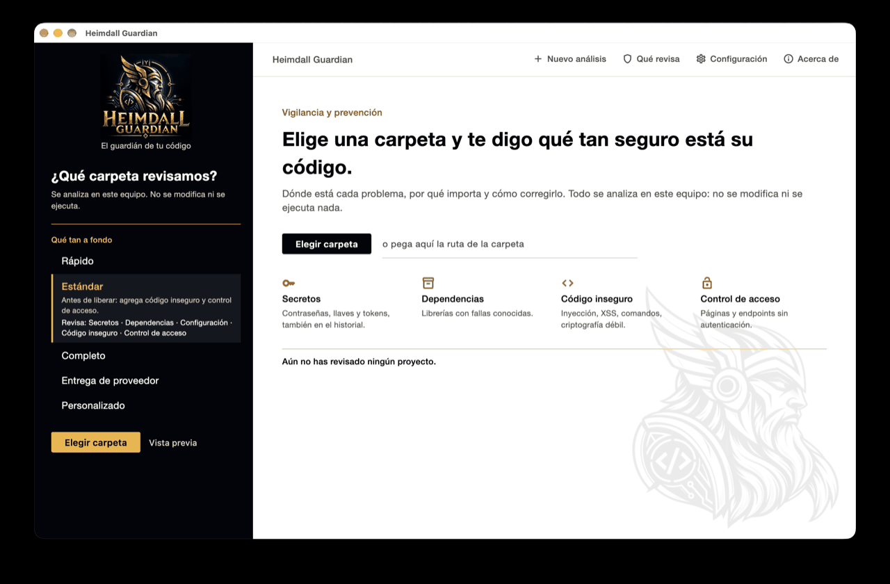
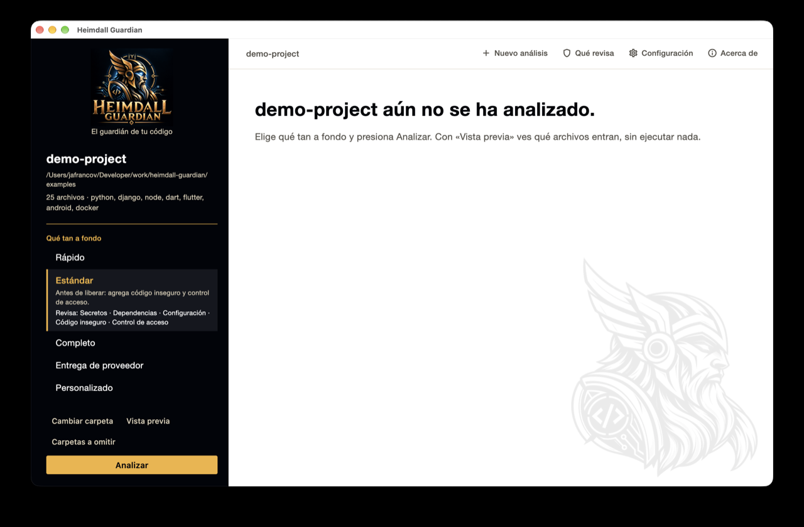
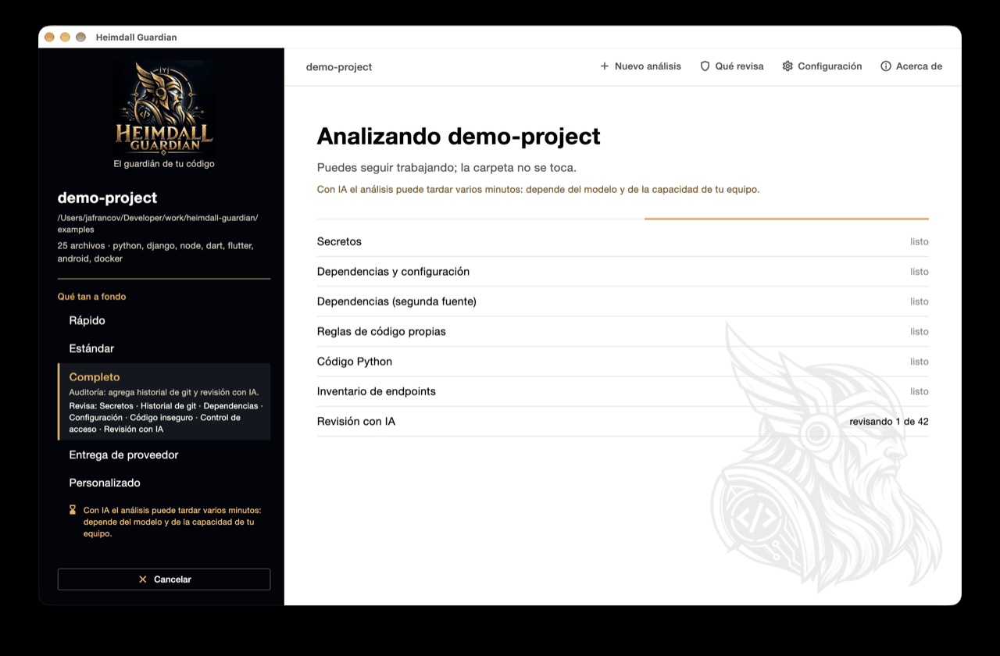
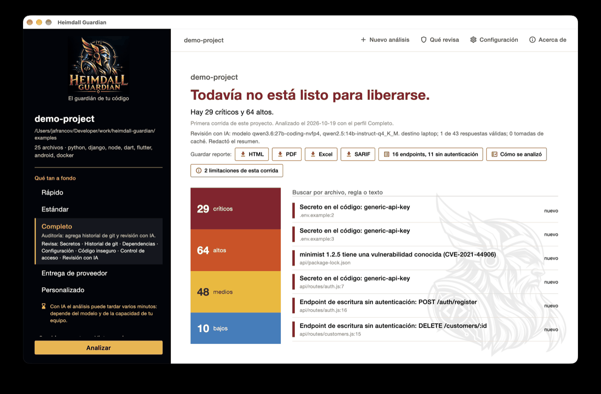
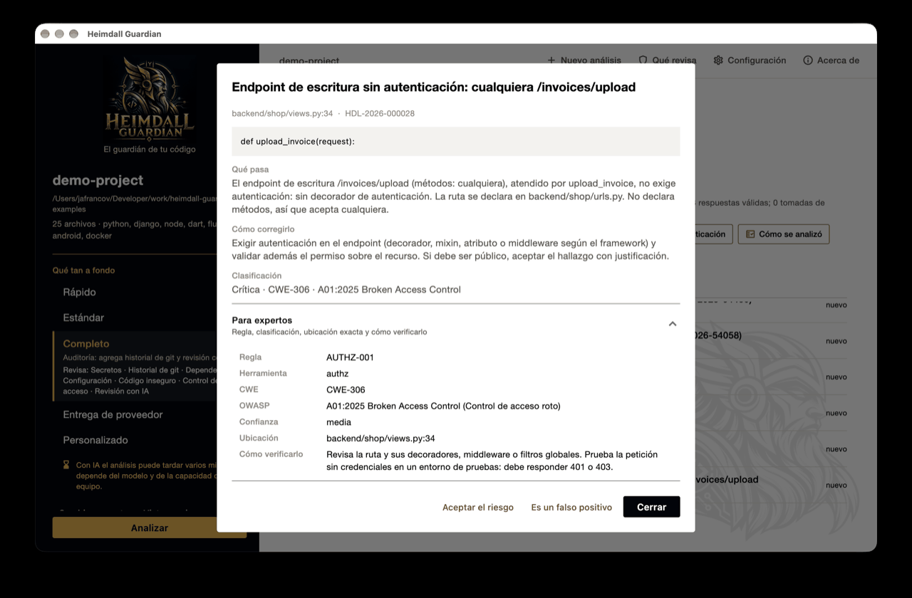

<p align="center">
  
</p>

# Heimdall Guardian

[](https://github.com/jafrancov/heimdall-guardian/actions/workflows/ci.yml)
[](LICENSE)

[Read in English → README.md](README.md)

**El guardián de tu código. Vigilancia y prevención.**

Heimdall Guardian revisa la seguridad del código fuente de una carpeta y te dice qué problema
hay, dónde está (archivo y línea), por qué importa y cómo corregirlo. Corre en tu
equipo: no modifica la carpeta, no ejecuta su código y no envía nada fuera de tu red.

Es un escáner local de seguridad estático y de solo lectura para código fuente (secretos,
dependencias vulnerables, código inseguro, endpoints sin autenticación), con aplicación de
escritorio y línea de comandos. La interfaz, los reportes y la revisión con IA están en
inglés y en español.

> **Nombre y marcas.** Heimdall Guardian es un proyecto independiente de código abierto.
> No está afiliado, patrocinado ni respaldado por ninguna empresa, producto o marca de
> nombre parecido. Las marcas que se mencionan pertenecen a sus respectivos titulares.

## Descarga e instala

Lo más sencillo es la aplicación de escritorio: sin Python, sin terminal y sin
herramientas adicionales que instalar.

| Sistema | Estado | Cómo |
|---|---|---|
| macOS (Apple Silicon) | Disponible | Descarga el `.dmg` de la [página de versiones](https://github.com/jafrancov/heimdall-guardian/releases), ábrelo y arrastra **Heimdall Guardian** a **Aplicaciones**. |
| Windows (x64) | Disponible | Descarga `heimdall-guardian-<versión>-windows-x64-setup.exe` de la [página de versiones](https://github.com/jafrancov/heimdall-guardian/releases) y ejecútalo. SmartScreen avisa la primera vez: pulsa **Más información** y luego **Ejecutar de todas formas**. |
| Linux (x64, Debian/Ubuntu) | Disponible | Descarga `heimdall-guardian_<versión>_amd64.deb` de la [página de versiones](https://github.com/jafrancov/heimdall-guardian/releases) y ejecuta `sudo apt install ./heimdall-guardian_<versión>_amd64.deb`, o extrae el `.tar.gz` y ejecuta el binario dentro de su carpeta `app/`. |


**La primera vez que la abras en macOS.** La aplicación aún no está firmada con un Apple
Developer ID, así que macOS te avisará. No hagas doble clic: en **Aplicaciones**, **clic
derecho → Abrir** y confirma **Abrir**. Solo hace falta la primera vez.

Al iniciar por primera vez verás una visita guiada corta que explica qué hace la
aplicación y qué no. Todo corre en tu equipo; no se envía nada fuera.

¿Prefieres correrla desde el código o usar la línea de comandos? Mira
[Instalación para desarrollo](#configurar-el-entorno-de-desarrollo) y
[Automatización y CI](#automatización-y-ci).

## Tu primer análisis

No necesitas ser experto en seguridad. Heimdall Guardian te dice qué problema hay, dónde
está y cómo corregirlo. Para practicar, usa el proyecto de demostración, pequeño y
vulnerable a propósito, en [`examples/demo-project`](examples/demo-project/README.md)
(nunca lo despliegues ni lo ejecutes).

**1. Abre la aplicación.** La bienvenida te pide elegir una carpeta. La primera vez aparece
la visita guiada.



**2. Elige la carpeta y qué tan a fondo revisar.** A la izquierda, elige la carpeta y la
profundidad: Rápido, Estándar, Completo, Entrega de proveedor o Personalizado. Cada opción
lista lo que revisa. **Vista previa** muestra qué archivos se incluirían y **Carpetas que
se omiten** te deja excluir algunas.



**3. Pulsa Analizar y mira el avance.** A la derecha ves cada paso mientras corre. No se
escribe nada en tu carpeta.



**4. Lee el resultado.** El resultado es una frase con colores de semáforo (rojo, ámbar o
verde) y una columna de bandas, una por severidad. Haz clic en una banda para filtrar la
lista. Guarda el reporte en HTML, PDF, Excel o SARIF con los botones de arriba.



**5. Abre un hallazgo.** Dice qué está pasando, **cómo corregirlo** y su clasificación. En
**Para expertos** ves la regla, la herramienta, el CWE y la categoría OWASP, la ubicación
exacta y cómo verificarlo.



**6. Decide qué hacer.** Corrige el código y analiza de nuevo, o usa **Aceptar el riesgo**
(por ejemplo, un sistema interno que no está expuesto) o **Es un falso positivo**. Ambas
piden una justificación, y un riesgo aceptado vuelve a contar cuando pasa su fecha de
revisión. El cambio se ve al instante en el resultado.

¿Quieres ver todas las pantallas? Haz el [recorrido por la app](docs/app-tour.es.md)
(también en el [sitio de documentación](https://jafrancov.github.io/heimdall-guardian/es/app-tour/)).
## Qué revisa

| Frente | Qué encuentra | Con qué |
|---|---|---|
| Secretos | Contraseñas, llaves y tokens, también en el historial de git | Gitleaks |
| Dependencias | Librerías con vulnerabilidades conocidas | Trivy y OSV-Scanner |
| Código inseguro | Inyección SQL, XSS, ejecución de comandos, deserialización, criptografía débil | Opengrep con más de 80 reglas propias, y Bandit |
| Configuración | `DEBUG` activo, CORS abierto, cookies inseguras, Dockerfile | Reglas propias y Trivy |
| Control de acceso | Inventario de endpoints y cuáles no exigen autenticación | Extractores propios para Django/DRF, ASP.NET, Laravel, PHP y Node.js |
| Revisión con IA (opcional) | Comprueba si la entrada del usuario llega a operaciones riesgosas, valora los hallazgos graves, revisa endpoints y redacta un resumen | Un modelo local (Ollama, LM Studio o vLLM) |

Además lleva **línea base** (qué es nuevo, qué persiste y qué se corrigió entre un
análisis y otro), permite **aceptar un riesgo** o marcar un **falso positivo** con
justificación, y para la recepción de código de terceros emite un **dictamen**
(aprobado, con observaciones o no aprobado) y un **SBOM** en CycloneDX.

Los reportes salen en HTML, PDF, Excel, SARIF y JSON.

Los hallazgos se clasifican con las categorías del **OWASP Top 10:2025**. En la aplicación,
el botón **Qué revisa** explica en palabras llanas qué es OWASP, qué significa cada
categoría y cuáles cubre Heimdall Guardian (sí, en parte o no), con los hallazgos abiertos de cada
una cuando ya hay un resultado. Los reportes traen lo mismo en la sección «Qué revisa
Heimdall Guardian». Cubrir una categoría no significa que no haya otros riesgos.

## Stacks soportados

Heimdall Guardian detecta el stack por nombres de archivo y manifiestos, sin ejecutar nada.
Secretos y configuración se revisan en cualquier proyecto; las dependencias se leen de
los archivos de bloqueo. Lo que aún no existe se declara en las limitaciones del
reporte.

| Stack | Secretos | Dependencias | Configuración | Reglas de código | Endpoints |
|---|---|---|---|---|---|
| Python | sí | sí | sí | sí (Bandit) | no |
| Django | sí | sí | sí | sí | sí |
| PHP y Laravel | sí | sí | sí | sí | sí |
| .NET | sí | sí | sí | sí | sí |
| Node.js y TypeScript (Express, NestJS) | sí | sí | sí | sí | sí |
| Dart y Flutter | sí | sí (`pubspec.lock`) | sí | sí | no (es cliente) |
| Swift (iOS) | sí | sí (`Package.resolved`, `Podfile.lock`) | sí | sí | no (es cliente) |
| Kotlin y Android | sí | sí (`gradle.lockfile`) | sí | sí | no (es cliente) |
| Java | sí | sí (`gradle.lockfile`, `pom.xml`) | sí | no | no |
| Go | sí | sí (`go.mod`) | sí | no | no |
| Ruby | sí | sí (`Gemfile.lock`) | sí | no | no |
| Rust | sí | sí (`Cargo.lock`) | sí | no | no |

Las dependencias solo se revisan si el proyecto trae su archivo de bloqueo y si la base
del ecosistema está descargada (`hdl databases --update`). `Podfile.lock` lo lee Trivy;
OSV-Scanner no lo soporta.

## Principios

1. **Solo lectura.** Nunca escribe dentro de la carpeta analizada.
2. **Nunca ejecuta el código analizado.** Las dependencias se leen de lockfiles y
   manifiestos; no se instala ni se compila nada.
3. **El código no sale de tu red.** La IA solo puede apuntar a `localhost` o a un
   servidor interno que tú autorices, por HTTPS. Se rechazan los modelos en la nube.
4. **Funciona sin internet.** Las herramientas van con versión fijada y verificada; las
   bases de vulnerabilidades se actualizan solo cuando lo pides.
5. **Determinístico primero, IA después.** La IA sugiere y nunca decide: no cambia la
   severidad de un hallazgo ni lo descarta.
6. **Trazabilidad.** Cada reporte registra el hash del código analizado y las versiones
   de herramientas, reglas, bases y modelo.

El código que se analiza se trata como hostil: no puede configurar las herramientas ni
ocultar hallazgos con archivos de exclusión o comentarios.

## Estado del proyecto

Es una versión previa a la 1.0, hecha y probada en macOS con Apple Silicon.

- Las reglas propias se probaron contra casos de prueba escritos para el proyecto, **no
  contra un conjunto amplio de proyectos reales**. Espera falsos positivos y huecos.
- La cobertura de .NET es menor que la de Python y PHP: se analiza como texto, sin
  compilar.
- La aplicación de escritorio no está firmada con un certificado de desarrollador.
- Los instaladores de Windows y Linux tampoco están firmados: SmartScreen de Windows avisa
  la primera vez que abres el instalador.
- La interfaz, los reportes y la revisión con IA están en inglés y en español. El texto de
  las reglas está en ambos; lo que escribe una herramienta externa (la descripción de un
  CVE, el mensaje de Bandit) se muestra tal cual.

**Es análisis estático.** No sustituye pruebas de penetración ni la revisión manual de
la lógica de negocio. Un resultado limpio no significa que el código sea seguro.

## Bases de vulnerabilidades

La revisión de dependencias necesita las bases de vulnerabilidades, que no vienen
incluidas (alrededor de 2 GB). Se descargan una vez y cuando quieras actualizarlas:

```bash
uv run hdl databases --update
```

En la aplicación hay dos formas: el botón **Actualizar las bases ahora** (en el panel
izquierdo y en Configuración) y la casilla **Actualizar las bases al analizar**, que
viene marcada cuando faltan o tienen más de una semana. Sin bases, el análisis corre de
todos modos y avisa que no se revisaron las dependencias.

### Qué se actualiza y cada cuánto

Solo las bases de vulnerabilidades cambian a diario; actualízalas cada semana o antes de
una revisión importante. Lo demás viene dentro de cada herramienta o de Heimdall Guardian y se
actualiza con una versión nueva de Heimdall Guardian: los patrones de secretos (Gitleaks), las
revisiones de configuración (Trivy), las de Python (Bandit) y las reglas propias que
corre Opengrep. Van fijadas a propósito: así el mismo código da el mismo resultado y el
reporte dice con qué versiones se hizo.

Para saber si alguna herramienta tiene una versión más nueva:

```bash
uv run hdl tools --news
```

Consulta GitHub y PyPI (solo la última versión de cada proyecto, nada de tu código) y
no descarga ni cambia nada.

## Uso

### Aplicación de escritorio

```bash
uv run hdl ui
```

Elige una carpeta, qué tan a fondo revisarla y presiona **Analizar**. El resultado es
una frase con el detalle de cada hallazgo. Con `--web --port 8551` se sirve en el
navegador en lugar de una ventana nativa.

¿Quieres ver un resultado antes de analizar tu código? Prueba el proyecto de demostración, una
app pequeña y vulnerable a propósito: `uv run hdl scan examples/demo-project --profile standard --output demo.html`
(ver [`examples/demo-project`](examples/demo-project/README.es.md)).

### Idioma

La interfaz, los reportes, los hallazgos y la revisión con IA están en inglés y en español.
El idioma se elige con, en orden de prioridad:

1. `hdl --lang es ...` (o `--lang en`), que gana sobre todo lo demás;
2. la variable de entorno `HDL_LANG` (`en` o `es`);
3. **Configuración → Idioma** en la aplicación, o `language = "es"` en `[general]` de
   `config.toml` (vacío: el del sistema);
4. el idioma del sistema, si es inglés o español (si no, español).

Un reporte se puede regenerar en el otro idioma: `hdl --lang en report <carpeta> ...`. Los
hallazgos conservan la misma huella en ambos idiomas, así que cambiar de idioma nunca
crea hallazgos «nuevos».

### Perfiles

| Perfil | Para qué | Qué revisa |
|---|---|---|
| `quick` | Revisión diaria | Secretos, dependencias y configuración |
| `standard` | Antes de liberar | Lo anterior, más código inseguro y control de acceso |
| `full` | Auditoría | Lo anterior, más historial de git y revisión con IA |
| `vendor` | Recibir código de terceros | Lo anterior, más SBOM y dictamen |
| `custom` | Tú eliges | `--modules SEC,DEP,SAST,...` |

### Carpetas que no se analizan

Puedes sumar tus propias reglas de Opengrep desde una carpeta fuera del proyecto (`[rules] extra_dirs` en `config.toml`, o **Configuración**): consulta [Tus propias reglas](docs/custom-rules.es.md).

Por defecto se omiten las carpetas de dependencias y de salida: `node_modules`, `venv`,
`.venv`, `vendor`, `bin`, `obj`, `dist`, `build`, `static/CACHE` y `migrations`.

- *En la aplicación:* **Carpetas a omitir** muestra las carpetas del proyecto; marca las
  que no quieras analizar (o desmarca una que se omite por defecto). Se recuerda por
  proyecto.
- *En la línea de comandos:* `--exclude generado --exclude docs/viejo`, o `--include build`
  para analizar una que se omite por defecto.
- *Para todos los proyectos:* `exclude_extra` e `include_extra` en la sección `[exclusions]` de `config.toml`, o
  **Configuración** en la aplicación.

También puedes omitir archivos por patrón: cualquier entrada con `*`, `?` o `[` es un
patrón de archivo (`--exclude '*.spec.ts'`, `docs/*.md`, o el campo **Archivos a omitir**).
Un patrón sin `/` se compara con el nombre del archivo; con `/`, con la ruta completa. Los
manifiestos y lockfiles (`package.json`, `package-lock.json`...) siempre se analizan, y los
secretos se buscan en todos los archivos.

Heimdall también *sugiere* carpetas según el stack detectado (`.next` y `coverage` en Node,
`Pods` y `DerivedData` en Swift, `.dart_tool` en Flutter...) y carpetas de editor o de
asistente de IA (`.context`, `.agents`, `.claude`, `.cursor`, `.idea`, `.vscode`). Aparecen
arriba en **Carpetas a omitir** y en `--dry-run`; no se omite nada hasta que guardes. Si
recibes código de un proveedor, las de editor y asistente empiezan sin marcar, porque ahí
se puede esconder código. También se sugieren las carpetas del `.gitignore` del proyecto, pero
solo como sugerencia: lo que dice el código analizado nunca configura el análisis.

Si la carpeta tiene varios proyectos separados (por ejemplo `api/`, `ios/` y `backend/`,
cada uno con su manifiesto y ninguno en la raíz), la aplicación los lista bajo el nombre
de la carpeta: analízala completa, o haz clic en uno para analizarlo por separado.
`--dry-run` también los lista.

Los reportes listan lo que no se analizó (carpetas y archivos omitidos). Los hallazgos de
análisis anteriores que quedan en un lugar que ahora omites cuentan como *omitidos*:
conservan su estado y nunca se reportan como corregidos.

`hdl scan <carpeta> --dry-run` y **Vista previa** muestran qué archivos entran.

### Recibir código de un proveedor

```bash
uv run hdl scan <carpeta> --profile vendor --issuer "Tu nombre" \
  --output dictamen.pdf --output sbom.cdx.json
```

El dictamen aplica umbrales (por ejemplo, cero hallazgos críticos, cero secretos, cero
endpoints de escritura sin autenticación). Se consultan con `hdl thresholds`; cambiarlos
pide un PIN y queda en bitácora.

### Por dónde empezar

**Por dónde empezar** (en la app y en cada reporte) agrupa los hallazgos abiertos por
causa común, del más grave al menos: una línea por paquete vulnerable con la versión que
corrige todos sus hallazgos, y una por regla con cuántos hallazgos y archivos abarca. No
incluye las sugerencias de IA.

### Aceptar un riesgo o descartar un falso positivo

```bash
uv run hdl suppress <carpeta> HDL-2026-000012 --status accepted \
  --reason "Sistema interno sin exposición" --review 2027-01-31
```

La justificación es obligatoria. Al vencer la fecha de revisión, el hallazgo vuelve a
contar. El cambio se refleja de inmediato en el último análisis y en sus reportes.

### Para quien revisa los hallazgos

**Llegar al punto exacto.**

- *Detalle del hallazgo:* abre el hallazgo y, en **Para expertos**, verás la regla, la
  herramienta, el CWE y la categoría OWASP, la confianza, la ubicación exacta
  (`archivo:línea`) y, cuando existe, **Cómo verificarlo** sin ejecutar el código ajeno.
  El reporte HTML trae la misma guía en cada hallazgo.
- *En tu editor:* `uv run hdl scan <carpeta> --output resultado.sarif` genera SARIF; los
  editores y GitHub lo muestran sobre la línea del código.
- *Cómo se analizó:* en el resultado, **Cómo se analizó** lista las herramientas con su
  versión, el modelo de IA si intervino y la antigüedad de las bases.

**Ajustar sin escribir reglas.**

- *Aceptar un riesgo o marcar un falso positivo*, con justificación y fecha de revisión
  (`hdl suppress`, ver arriba). `hdl suppressions <carpeta>` los lista y
  `hdl unsuppress <carpeta> <id>` los retira.
- *Carpetas a omitir:* `--exclude` e `--include` en `hdl scan`, o **Carpetas a omitir** en
  la aplicación (ver arriba).
- *Compartir la línea base* con otra persona o equipo, para que vea las mismas
  supresiones:

  ```bash
  uv run hdl baseline <carpeta> --export .heimdall-baseline.json
  uv run hdl baseline <otra-carpeta> --import .heimdall-baseline.json
  ```

### Revisión con IA (modelos locales con Ollama)

Es opcional, y **puede tardar varios minutos**: depende del modelo y de la capacidad
de tu equipo. Solo corre en los perfiles `full` y `vendor` o en uno personalizado
que incluya el módulo IA, y usa un modelo que se ejecute **en tu equipo o en tu red**:
nunca un servicio en la nube. Lo más sencillo es [Ollama](https://ollama.com).

**1. Instala Ollama** desde [ollama.com/download](https://ollama.com/download) y déjalo
abierto. Escucha en `http://localhost:11434`.

**2. Descarga un modelo.** Los nombres disponibles están en
[ollama.com/library](https://ollama.com/library).

```bash
ollama pull qwen2.5-coder:14b      # ejemplo: un modelo orientado a código
ollama list                        # los que ya tienes, con su nombre exacto
```

**3. Regístralo en Heimdall Guardian.** Hay dos formas; usa el nombre tal como aparece en
`ollama list`, con todo y etiqueta (por ejemplo `qwen2.5-coder:14b`).

- *En la aplicación:* **Configuración → Revisión con IA**. Marca «Usar la revisión con
  IA», deja la dirección `http://localhost:11434/v1` y escribe el modelo en cada campo.
  **Probar conexión** lista los modelos que el servidor ofrece. Luego **Guardar**.
- *En el archivo:* `uv run hdl config --init` crea `config.toml` y muestra dónde quedó.

```toml
[llm]
enabled = true
active_destination = "laptop"

[[llm.destinations]]
name = "laptop"
runtime = "ollama"
url = "http://localhost:11434/v1"
model_triage = "qwen2.5-coder:14b"       # valora si un hallazgo grave es real
model_endpoints = "qwen2.5-coder:14b"    # revisa el control de acceso de cada endpoint
model_summary = "qwen2.5-coder:14b"      # redacta el resumen ejecutivo
model_consensus = "<unset>"              # opcional: segundo modelo de contraste
```

Las claves de `config.toml` están en inglés (`[general]`, `[exclusions]`, `[databases]`,
`[llm]`). Un archivo de una versión anterior, con claves en español, no se lee:
renómbralo o bórralo y crea uno nuevo con `hdl config --init`.

#### Varias configuraciones de IA

Puedes registrar varias, cada una con su servidor y sus cuatro modelos. También puede ser
el mismo servidor con otros modelos: por ejemplo, «gpu» con `qwen2.5-coder:14b` y
`qwen3:14b`, y «gpu-ligero» con modelos de 7B para pruebas rápidas.

- En **Configuración → Revisión con IA**, **Agregar configuración de IA** añade una
  (con la dirección de la última, para que solo cambies los modelos) y el icono de
  papelera la quita. Cada una tiene su propio **Probar conexión**.
- **Usar** elige la que se aplica por omisión; **Si no responde, usar** elige una de
  respaldo, con sus propios modelos, para cuando el servidor principal no conteste.
- Con más de una, al elegir un análisis con IA aparece **IA para este análisis** en el
  panel izquierdo, para usar otra solo esa vez sin cambiar la configuración.
- En la línea de comandos: `hdl scan <carpeta> --profile full --ai gpu-ligero`, y
  `hdl llm --destination gpu-ligero` para probarla.

En el archivo, cada configuración es un bloque `[[llm.destinations]]` con su `name`;
`active_destination` y `fallback_destination` usan esos nombres (`"none"`: sin respaldo).

**4. Compruébalo.**

```bash
uv run hdl llm      # conexión, modelos disponibles y una consulta de prueba
```

Después de un análisis, el botón **Cómo se analizó** dice qué modelo intervino, cuántas
respuestas dio y si redactó el resumen. `hdl llm --save-token` guarda el token de un destino en el llavero
del sistema, nunca en `config.toml`.

#### Qué modelo elegir

- **Para valorar hallazgos y endpoints, uno orientado a código** (los que llevan
  `coder` o `code` en el nombre) y de tipo *instruct*. Leen mejor el código y siguen
  mejor el formato de respuesta que se les pide.
- **Para el resumen, cualquier modelo general con buen español.** Solo recibe cifras,
  nunca código; puede ser uno más pequeño.
- **El tamaño depende de tu memoria.** Como referencia, un modelo de 7 a 8 mil millones
  de parámetros pide unos 8 GB libres; uno de 14, unos 12 GB; uno de 30 o más, de 24 GB
  en adelante. Si el equipo se queda sin memoria, baja de tamaño antes que de calidad
  de cuantización.
- **Un segundo modelo distinto en `model_consensus`** hace que cada hallazgo lo valoren
  dos: si coinciden sube la confianza y si discrepan baja. Tarda el doble.
- **No sirven** los modelos de *embeddings* (como `bge-m3`) ni los que terminan en
  `:cloud`: estos últimos envían el código fuera y Heimdall Guardian los rechaza.

El proyecto se probó con `qwen2.5:14b-instruct` en una Mac con 36 GB. No hay una
comparación amplia entre modelos: toma estas pautas como punto de partida.

#### Qué hace y qué no hace la IA

Comprueba si la entrada del usuario llega a las operaciones riesgosas que marcan las reglas
candidatas (solo genera un hallazgo de IA si llega, y nunca pasa de MEDIO), valora los
hallazgos críticos y altos, revisa los endpoints y redacta un resumen. No
recorre todo el repositorio, no cambia la severidad de un hallazgo y no lo descarta
aunque opine que es falso: sus resultados aparecen siempre marcados como sugerencia.
El código se le envía sin comentarios y con los secretos enmascarados, y las respuestas
se guardan en caché, así que repetir un análisis sin cambios es casi inmediato.

También funcionan [LM Studio](https://lmstudio.ai) (`http://localhost:1234/v1`) y un
servidor propio con vLLM, porque usan la misma API. Un servidor que no sea `localhost`
debe usar HTTPS y estar en `allowed_hosts`.

### Sin internet

```bash
uv run hdl databases --export bases.tar.gz     # en un equipo con conexión
uv run hdl databases --import bases.tar.gz     # en el equipo aislado
```

(`hdl bases` es un alias de `hdl databases`.)

## Automatización y CI

La línea de comandos `hdl` es para scripts e integración continua: el mismo análisis sin
ventana. En un pipeline, genera un reporte SARIF o JSON y deja que tu CI lo muestre o
falle la compilación. Todo lo que hace la aplicación también está disponible aquí.

### Instalar solo el comando

Para usar `hdl` sin la aplicación de escritorio (un servidor, una máquina de CI, un flujo
solo de terminal) necesitas tu propio Python 3.12 o superior de
[python.org](https://www.python.org/downloads/); el Python que trae macOS o Xcode es
demasiado viejo. Descarga `install_hdl.py` de la
[página de versiones](https://github.com/jafrancov/heimdall-guardian/releases) (la
aplicación de escritorio también lo trae) y ejecútalo. Con la aplicación de escritorio ni
siquiera lo necesitas: ofrece instalar el comando la primera vez que se abre, y otra vez en
Configuración, en "Línea de comandos" (necesita Python 3.12 o superior en el equipo y te
dice dónde conseguirlo si falta). En un servidor sin escritorio, descarga de la misma
página el archivo solo de línea de comandos `heimdall-guardian-cli-<versión>.tar.gz`: trae
`install_hdl.py`, el paquete `.whl` y un README corto, así que
`python3 install_hdl.py --wheel <el archivo .whl>` instala sin descargar el paquete. En Debian
y Ubuntu, instala antes `python3-venv` (`sudo apt install python3-venv`): sin él, el
instalador no puede crear su entorno virtual.

```bash
python3 install_hdl.py              # crea su propio entorno virtual y enlaza `hdl`
hdl tools --install                 # descarga Gitleaks, OSV-Scanner, Opengrep y Trivy
hdl databases --update              # bases de vulnerabilidades
```

El entorno vive en la carpeta de datos (`<datos>/cli/venv`), nada más de tu Python cambia y
`hdl` queda enlazado en `~/.local/bin` (en Windows, un acceso bajo
`%LOCALAPPDATA%\Programs\Heimdall Guardian\bin` que se agrega a tu PATH de usuario).
Comparte herramientas, bases e historial con la aplicación de escritorio: si la app está
instalada, `hdl` reutiliza sus herramientas. `hdl tools --install` descarga cada binario
fijado y verifica su SHA-256 antes de instalarlo; en un equipo sin internet, copia la
carpeta `tools` desde uno que tenga la app. Para quitar el comando, ejecuta
`python3 install_hdl.py --uninstall`: borra el entorno y el enlace, nunca tus bases,
historial ni ajustes.

Sin la app ni el script también puedes usar un instalador de herramientas de Python, cuando
el paquete esté publicado en PyPI (cuando se publique): `uv tool install heimdall-guardian` o
`pipx install heimdall-guardian`, y luego `hdl tools --install` para obtener las herramientas
fijadas. De cualquier forma, `hdl version --check` consulta GitHub (solo cuando lo ejecutas, sin
enviar nada de tu código) si hay una versión nueva y te dice dónde descargarla; `hdl tools --news`
incluye la misma línea. En la app de escritorio, "Buscar actualizaciones" en Acerca de hace lo mismo.

### Línea de comandos

```bash
uv run hdl scan <carpeta> --profile standard --output reporte.html
uv run hdl scan <carpeta> --dry-run          # qué se analizaría, sin ejecutar nada
uv run hdl report <carpeta> --output reporte.pdf --output reporte.xlsx
uv run hdl runs <carpeta>                    # análisis guardados
uv run hdl tools                             # herramientas disponibles y su versión
uv run hdl tools --news                      # ¿hay versiones más nuevas? (consulta internet)
```

Los nombres de los subcomandos y de las opciones están en inglés. Los nombres anteriores,
en español (`herramientas`, `bases`, `--perfil`, `--salida`, `--actualizar-bases`,
`--excluir`, `--incluir`, `--emite`, `--sin-linea-base`, `--corrida`, `--estado`,
`--motivo`, `--revisar`, `--si`, `--destino`, `--guardar-token`, `--actualizar`,
`--exportar`, `--importar`, `--novedades`, `--definir-pin`, `--bitacora`, `--ia`,
`--modulos`), siguen funcionando como alias, así que tus guiones no se rompen. Los perfiles
se pueden escribir como `quick`, `standard`, `full`, `vendor` y `custom` o con los códigos
de siempre (`rapido`, `estandar`, `completo`, `proveedor`, `personalizado`); el estado de
una supresión, como `accepted` o `false_positive` (también `aceptado`, `falso-positivo`).
La ayuda (`hdl --help`) sale en el idioma activo.

El formato de cada `--output` sale de su extensión: `.html`, `.pdf`, `.xlsx`, `.sarif`,
`.json` o `.cdx.json` (SBOM). Los reportes no se pueden guardar dentro de la carpeta
analizada.

## Solución de problemas

**«Faltan las bases de vulnerabilidades».** Es normal la primera vez: usa **Actualizar
las bases ahora** o `uv run hdl databases --update`. Mientras tanto el análisis corre,
pero no revisa dependencias.

**La descarga de la base de Trivy falla con `error getting credentials` o
`docker-credential-desktop: executable file not found`.** Corregido desde la versión
0.1.0; se explica aquí por si reaparece con otra herramienta.

Trivy distribuye su base de vulnerabilidades como un artefacto en un registro de
contenedores (el mismo tipo de servidor que guarda imágenes de Docker), aunque no use
Docker para nada. Como cualquier cliente de esos registros, antes de descargar revisa
si hay credenciales guardadas en `~/.docker/config.json`. Si tienes Docker Desktop, ese
archivo dice `"credsStore": "desktop"`, que significa «pídele las credenciales al
programa `docker-credential-desktop`».

Desde una terminal ese programa se encuentra y todo funciona. Pero una aplicación de
escritorio en macOS arranca con un `PATH` mínimo (`/usr/bin:/bin`), sin las carpetas de
Docker ni de Homebrew: Trivy no encuentra el programa y cancela la descarga, aunque la
base es pública y no necesita credenciales.

Heimdall Guardian lo evita indicándole a Trivy una carpeta de configuración de Docker vacía, así
descarga de forma anónima. No se leen ni se usan tus credenciales de Docker.

**El análisis con IA tarda mucho.** Depende del modelo y de tu equipo. Usa un modelo más
pequeño, o el perfil `standard`, que no usa IA. Las respuestas se guardan en caché:
repetir un análisis sin cambios es casi inmediato.

**«No está instalada» junto a una herramienta.** Ejecuta `make tools` (desarrollo) o
reinstala la aplicación; cada herramienta también se puede indicar con
`HDL_<NOMBRE>_BIN`.

## Construir la aplicación de macOS

Requiere Flutter y Xcode.

```bash
make app
```

Genera `build/macos/heimdall-guardian.app` y `dist/HeimdallGuardian-<versión>-<arquitectura>.dmg`
(con `Heimdall Guardian.app` dentro), con las reglas y las
herramientas. Al abrir el `.dmg` aparecen la aplicación y un acceso directo a
Aplicaciones: se instala arrastrando una sobre el otro.

No está firmado: en otra Mac hay que abrirlo con clic derecho → Abrir, o firmarlo y
notarizarlo con tu propio certificado.

## Desarrollo

### Configurar el entorno de desarrollo

Requisitos: Python 3.12 o posterior, [uv](https://docs.astral.sh/uv/), git y
[pre-commit](https://pre-commit.com/).

```bash
git clone https://github.com/jafrancov/heimdall-guardian.git
cd heimdall-guardian
make setup
```

`make setup` instala las dependencias, descarga Gitleaks, OSV-Scanner, Opengrep y Trivy
en las versiones fijadas en `tools/tools.toml` (verificando su SHA-256) y activa los
hooks de calidad.

### Control de calidad

```bash
pre-commit run --all-files     # todo el control de calidad
uv run pytest --cov            # pruebas
```

El control de calidad (formato, tipos, pruebas y cobertura) corre en cada commit y en
la integración continua. `CLAUDE.md` (en inglés) describe la arquitectura y las convenciones del
código.

Para proponer una regla, un extractor de endpoints u otro cambio, lee
[CONTRIBUTING.es.md](CONTRIBUTING.es.md) ([in English](CONTRIBUTING.md)).

### Sitio de documentación

La documentación (primeros pasos, configuración, IA local, el catálogo de reglas generado y
la referencia de comandos) se construye con MkDocs Material y se publica en
<https://jafrancov.github.io/heimdall-guardian/>.
Para construirla en local: `make docs` (o `make docs-serve` para verla en vivo).

## Contribuidores

Heimdall Guardian lo escribe y mantiene Alejandro Franco
([@jafrancov](https://github.com/jafrancov)) con ayuda de la comunidad. Cada contribución
aceptada (código, reglas, traducciones, documentación o reportes de falsos positivos) gana un
lugar en [CONTRIBUTORS.es.md](CONTRIBUTORS.es.md) ([in English](CONTRIBUTORS.md)). Sigue el
[Código de conducta](CODE_OF_CONDUCT.es.md).

## Seguridad

Para reportar una vulnerabilidad en Heimdall Guardian, consulta [SECURITY.es.md](SECURITY.es.md) ([in English](SECURITY.md)).

## Licencia

Código y reglas: [Apache-2.0](LICENSE). Copyright 2026 Alejandro Franco.

El instalador incluye ejecutables de otros proyectos, sin modificar, cada uno con su
licencia. El detalle está en [THIRD-PARTY-NOTICES.es.md](THIRD-PARTY-NOTICES.es.md) ([in English](THIRD-PARTY-NOTICES.md)).

### Aviso sobre los elementos gráficos

Los elementos gráficos de HEIMDALL fueron desarrollados mediante un proceso creativo
asistido por herramientas de inteligencia artificial, con decisiones de selección,
adaptación y definición de identidad realizadas durante el desarrollo del proyecto. Su
utilización y protección estarán sujetas a los derechos efectivamente reconocidos por la
legislación aplicable.
