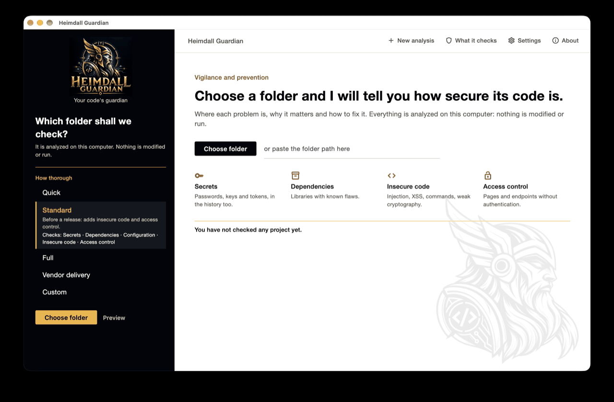
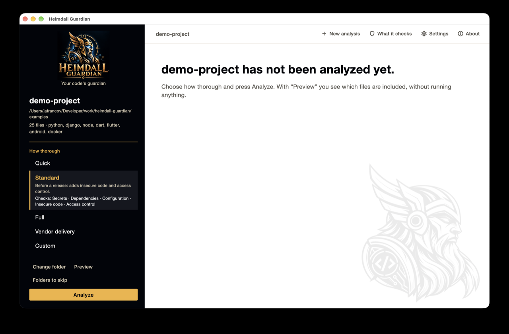
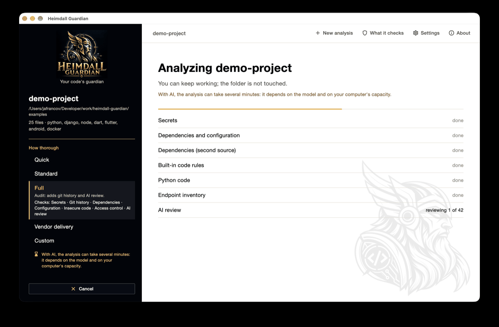
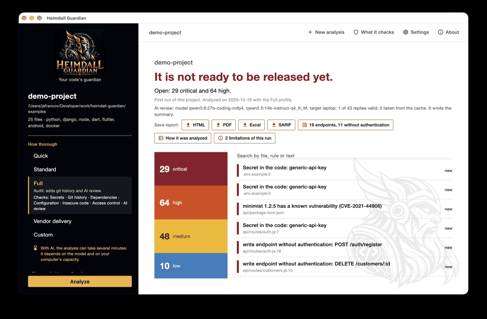
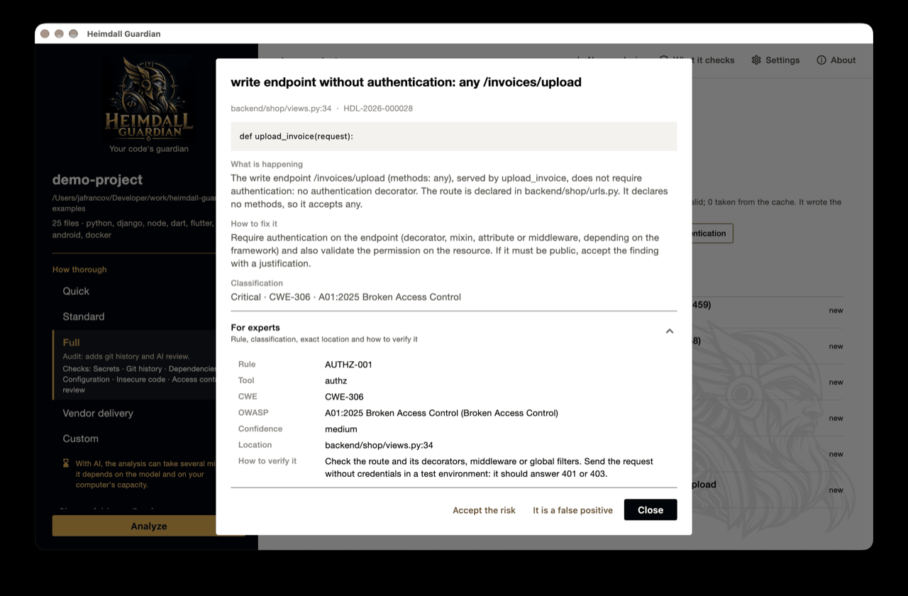

<p align="center">
  
</p>

# Heimdall Guardian

[](https://github.com/jafrancov/heimdall-guardian/actions/workflows/ci.yml)
[](LICENSE)

[Leer en español → README.es.md](README.es.md)

**The guardian of your code. Vigilance and prevention.**

Heimdall Guardian reviews the security of the source code in a folder and tells you what
the problem is, where it is (file and line), why it matters and how to fix it. It runs on
your machine: it does not modify the folder, does not run its code and sends nothing
outside your network.

It is a local, read-only static security scanner for source code (secrets, vulnerable
dependencies, insecure code, unauthenticated endpoints) with a desktop app and a command
line. The interface, the reports and the AI review are available in English and Spanish.

> **Name and trademarks.** Heimdall Guardian is an independent open-source project. It is
> not affiliated with, sponsored or endorsed by any company, product or brand with a
> similar name. Trademarks mentioned belong to their respective owners.

## Download and install

The simplest way is the desktop app: no Python, no terminal and no extra tools to install.

| System | Status | How |
|---|---|---|
| macOS (Apple Silicon) | Available | Download the `.dmg` from the [Releases page](https://github.com/jafrancov/heimdall-guardian/releases), open it and drag **Heimdall Guardian** onto **Applications**. |
| Windows (x64) | Available | Download `heimdall-guardian-<version>-windows-x64-setup.exe` from the [Releases page](https://github.com/jafrancov/heimdall-guardian/releases) and run it. SmartScreen warns the first time: click **More info** and then **Run anyway**. |
| Linux (x64, Debian/Ubuntu) | Available | Download `heimdall-guardian_<version>_amd64.deb` from the [Releases page](https://github.com/jafrancov/heimdall-guardian/releases) and run `sudo apt install ./heimdall-guardian_<version>_amd64.deb`, or extract the `.tar.gz` and run the binary inside its `app/` folder. |


**First time you open it on macOS.** The app is not yet signed with an Apple Developer ID,
so macOS will warn you the first time. Do not double-click it: in **Applications**, **right
click → Open** and confirm **Open**. You only need to do this once.

The first time it starts, a short guided tour explains what the app does and what it does
not do. Everything runs on your machine; nothing is sent out.

Prefer to run it from source or use the command line? See
[Installation for development](#setting-up-the-development-environment) and
[Automation and CI](#automation-and-ci).

## Your first analysis

You do not need to be a security expert. Heimdall Guardian tells you what the problem is,
where it is and how to fix it. To practice, use the small, deliberately vulnerable demo
project in [`examples/demo-project`](examples/demo-project/README.md) (never deploy or run
it).

**1. Open the app.** The welcome screen asks you to choose a folder. The guided tour
appears the first time.



**2. Choose the folder and how thorough the review should be.** On the left, pick the
folder and a depth: Quick, Standard, Full, Vendor delivery or Custom. Each option lists
what it checks. **Preview** shows which files would be included and **Folders to skip**
lets you leave some out.



**3. Press Analyze and watch the progress.** The right side shows each step as it runs.
Nothing is written to your folder.



**4. Read the result.** The result is a sentence in traffic-light colors (red, amber or
green) and a column of bands, one per severity. Click a band to filter the list. Save the
report as HTML, PDF, Excel or SARIF from the buttons above.



**5. Open a finding.** It says what is happening, **how to fix it** and its classification.
Under **For experts** you get the rule, the tool, the CWE and OWASP category, the exact
location and how to verify it.



**6. Decide what to do.** Fix the code and analyze again, or use **Accept the risk** (for
example, an internal system that is not exposed) or **It is a false positive**. Both need a
justification, and an accepted risk is shown again when its review date passes. The change
shows up immediately in the result.

Want to see every screen? Take the [desktop app tour](docs/app-tour.md) (also on the
[documentation site](https://jafrancov.github.io/heimdall-guardian/app-tour/)).
## What it checks

| Area | What it finds | With what |
|---|---|---|
| Secrets | Passwords, keys and tokens, also in git history | Gitleaks |
| Dependencies | Libraries with known vulnerabilities | Trivy and OSV-Scanner |
| Insecure code | SQL injection, XSS, command execution, deserialization, weak cryptography | Opengrep with more than 80 own rules, and Bandit |
| Configuration | `DEBUG` on, open CORS, insecure cookies, Dockerfile | Own rules and Trivy |
| Access control | Endpoint inventory and which ones do not require authentication | Own extractors for Django/DRF, ASP.NET, Laravel, PHP and Node.js |
| AI review (optional) | Checks whether user input reaches risky operations, assesses serious findings, reviews endpoints and writes a summary | A local model (Ollama, LM Studio or vLLM) |

It also keeps a **baseline** (what is new, what persists and what was fixed between one
analysis and the next), lets you **accept a risk** or mark a **false positive** with a
justification, and, for receiving third-party code, issues a **verdict** (approved, with
observations or not approved) and a CycloneDX **SBOM**.

Reports come in HTML, PDF, Excel, SARIF and JSON.

Findings are classified with the **OWASP Top 10:2025** categories. In the app, the
**What it checks** button explains in plain words what OWASP is, what each category means
and which ones Heimdall Guardian covers (yes, partly or no), with the open findings of
each one once there is a result. The reports carry the same in the "What Heimdall Guardian
checks" section. Covering a category does not mean there are no other risks.

## Supported stacks

Heimdall Guardian detects the stack from file names and manifests, without running
anything. Secrets and configuration are checked in any project; dependencies are read
from lock files. What does not exist yet is declared in the report's limitations.

| Stack | Secrets | Dependencies | Configuration | Code rules | Endpoints |
|---|---|---|---|---|---|
| Python | yes | yes | yes | yes (Bandit) | no |
| Django | yes | yes | yes | yes | yes |
| PHP and Laravel | yes | yes | yes | yes | yes |
| .NET | yes | yes | yes | yes | yes |
| Node.js and TypeScript (Express, NestJS) | yes | yes | yes | yes | yes |
| Dart and Flutter | yes | yes (`pubspec.lock`) | yes | yes | no (it is a client) |
| Swift (iOS) | yes | yes (`Package.resolved`, `Podfile.lock`) | yes | yes | no (it is a client) |
| Kotlin and Android | yes | yes (`gradle.lockfile`) | yes | yes | no (it is a client) |
| Java | yes | yes (`gradle.lockfile`, `pom.xml`) | yes | no | no |
| Go | yes | yes (`go.mod`) | yes | no | no |
| Ruby | yes | yes (`Gemfile.lock`) | yes | no | no |
| Rust | yes | yes (`Cargo.lock`) | yes | no | no |

Dependencies are only checked if the project ships its lock file and the ecosystem's
database has been downloaded (`hdl databases --update`). `Podfile.lock` is read by Trivy;
OSV-Scanner does not support it.

## Principles

1. **Read-only.** It never writes inside the analyzed folder.
2. **It never runs the analyzed code.** Dependencies are read from lock files and
   manifests; nothing is installed or compiled.
3. **Your code does not leave your network.** The AI can only point to `localhost` or to
   an internal server that you authorize, over HTTPS. Cloud models are rejected.
4. **It works offline.** The tools ship with pinned, verified versions; the vulnerability
   databases are updated only when you ask.
5. **Deterministic first, AI second.** The AI suggests and never decides: it does not
   change a finding's severity or discard it.
6. **Traceability.** Every report records the hash of the analyzed code and the versions
   of tools, rules, databases and model.

The analyzed code is treated as hostile: it cannot configure the tools or hide findings
with exclusion files or comments.

## Project status

It is a pre-1.0 release, built and tested on macOS with Apple Silicon.

- The own rules were tested against test cases written for the project, **not against a
  broad set of real projects**. Expect false positives and gaps.
- .NET coverage is lower than Python's and PHP's: it is analyzed as text, without
  compiling.
- The desktop app is not signed with a developer certificate.
- The Windows and Linux installers are not signed either: Windows SmartScreen warns the
  first time you open the installer.
- The interface, reports and AI review are available in English and Spanish. The text of
  the rules is in both; what an external tool writes (a CVE description, a Bandit
  message) is shown as is.

**It is static analysis.** It does not replace penetration testing or manual review of
business logic. A clean result does not mean the code is secure.

## Vulnerability databases

The dependency check needs the vulnerability databases, which are not included (about
2 GB). Download them once and whenever you want to update them:

```bash
uv run hdl databases --update
```

In the app there are two ways: the **Update the databases now** button (in the left panel
and in Settings) and the **Update the databases when analyzing** checkbox, which comes
ticked when they are missing or more than a week old. Without databases the analysis runs
anyway and warns that dependencies were not checked.

### What gets updated and how often

Only the vulnerability databases change daily; update them every week or before an
important review. Everything else ships inside each tool or inside Heimdall Guardian and
is updated with a new Heimdall Guardian version: the secret patterns (Gitleaks), the
configuration checks (Trivy), the Python ones (Bandit) and the own rules that Opengrep
runs. They are pinned on purpose: that way the same code gives the same result and the
report says which versions it was made with.

To find out whether a tool has a newer version:

```bash
uv run hdl tools --news
```

It queries GitHub and PyPI (only the latest version of each project, nothing from your
code) and downloads or changes nothing.

## Usage

### Desktop app

```bash
uv run hdl ui
```

Pick a folder, how thorough the review should be and press **Analyze**. The result is a
sentence with the detail of each finding. With `--web --port 8551` it is served in the
browser instead of a native window.

Want to see a result before analyzing your own code? Try the demo project, a small and
deliberately vulnerable app: `uv run hdl scan examples/demo-project --profile standard --output demo.html`
(see [`examples/demo-project`](examples/demo-project/README.md)).

### Language

The interface, reports, findings and AI review are available in English and Spanish.
Choose the language with, in order of priority:

1. `hdl --lang en ...` (or `--lang es`), which wins over everything else;
2. the `HDL_LANG` environment variable (`en` or `es`);
3. **Settings → Language** in the app, or `language = "en"` under `[general]` in
   `config.toml` (empty: follow the system);
4. the system language, if it is English or Spanish (otherwise Spanish).

Reports can be regenerated in the other language: `hdl --lang es report <folder> ...`.
Findings keep the same fingerprint in both languages, so switching language never creates
"new" findings.

### Profiles

| Profile | What for | What it checks |
|---|---|---|
| `quick` | Daily check | Secrets, dependencies and configuration |
| `standard` | Before a release | The above, plus insecure code and access control |
| `full` | Audit | The above, plus git history and AI review |
| `vendor` | Receiving third-party code | The above, plus SBOM and verdict |
| `custom` | You choose | `--modules SEC,DEP,SAST,...` |

### Folders that are not analyzed

You can add your own Opengrep rules from a folder outside the project (`[rules] extra_dirs` in `config.toml`, or **Settings**): see [Your own rules](docs/custom-rules.md).

By default, dependency and output folders are skipped: `node_modules`, `venv`, `.venv`,
`vendor`, `bin`, `obj`, `dist`, `build`, `static/CACHE` and `migrations`.

- *In the app:* **Folders to skip** shows the project's folders; tick the ones you do not
  want analyzed (or untick one that is skipped by default). It is remembered per project.
- *On the command line:* `--exclude generated --exclude docs/old`, or `--include build`
  to analyze one that is skipped by default.
- *For all projects:* `exclude_extra` and `include_extra` in the `[exclusions]` section
  of `config.toml`, or **Settings** in the app.

Files can be skipped by pattern too: any entry with `*`, `?` or `[` is a file pattern
(`--exclude '*.spec.ts'`, `docs/*.md`, or the **Files to skip** field). A pattern without
`/` matches the file name; with `/`, the whole path. Manifests and lockfiles
(`package.json`, `package-lock.json`...) are always analyzed, and secrets are searched in
every file.

Heimdall also *suggests* folders from the detected stack (`.next` and `coverage` in Node,
`Pods` and `DerivedData` in Swift, `.dart_tool` in Flutter...) and editor or AI-assistant
folders (`.context`, `.agents`, `.claude`, `.cursor`, `.idea`, `.vscode`). They appear at
the top of **Folders to skip** and in `--dry-run`; nothing is skipped until you save. When
receiving vendor code, the editor and assistant folders start unchecked, because code can
hide there. Folders listed in the project's `.gitignore` are suggested too, but
only as suggestions: what the analyzed code says never configures the analysis.

If the folder holds several separate projects (for example `api/`, `ios/` and
`backend/`, each with its own manifest and none at the root), the app lists them under the
folder name: analyze it all together, or click one to analyze it on its own. `--dry-run`
lists them as well.

Reports list what was not analyzed (omitted folders and files). Findings from earlier
runs that sit in a place you now skip are counted as *omitted*: they keep their status and
are never reported as fixed.

`hdl scan <folder> --dry-run` and **Preview** show which files are included.

### Receiving code from a vendor

```bash
uv run hdl scan <folder> --profile vendor --issuer "Your name" \
  --output verdict.pdf --output sbom.cdx.json
```

The verdict applies thresholds (for example, zero critical findings, zero secrets, zero
unauthenticated write endpoints). View them with `hdl thresholds`; changing them asks for
a PIN and is logged.

### Where to start

**Where to start** (in the app and in every report) groups the open findings by common
cause, worst first: one line per vulnerable package with the version that fixes all of its
findings, and one line per rule with how many findings and files it covers. AI suggestions
are not included.

### Accepting a risk or dismissing a false positive

```bash
uv run hdl suppress <folder> HDL-2026-000012 --status accepted \
  --reason "Internal system, not exposed" --review 2027-01-31
```

The justification is mandatory. When the review date passes, the finding counts again.
The change shows up immediately in the latest analysis and its reports.

### For reviewers

**Getting to the exact spot.**

- *Finding detail:* open the finding and, under **For experts**, you will see the rule,
  the tool, the CWE and OWASP category, the confidence, the exact location
  (`file:line`) and, when available, **How to verify it** without running the foreign
  code. The HTML report carries the same guidance on each finding.
- *In your editor:* `uv run hdl scan <folder> --output result.sarif` produces SARIF;
  editors and GitHub show it on the line of code.
- *How it was analyzed:* in the result, **How it was analyzed** lists the tools with their
  version, the AI model if one took part and the age of the databases.

**Adjusting without writing rules.**

- *Accept a risk or mark a false positive*, with a justification and review date
  (`hdl suppress`, see above). `hdl suppressions <folder>` lists them and
  `hdl unsuppress <folder> <id>` removes them.
- *Folders to skip:* `--exclude` and `--include` in `hdl scan`, or **Folders to skip** in
  the app (see above).
- *Share the baseline* with another person or team, so they see the same suppressions:

  ```bash
  uv run hdl baseline <folder> --export .heimdall-baseline.json
  uv run hdl baseline <other-folder> --import .heimdall-baseline.json
  ```

### AI review (local models with Ollama)

It is optional, and **it can take several minutes**: it depends on the model and on your
machine. It only runs in the `full` and `vendor` profiles, or in a custom one that
includes the AI module, and it uses a model that runs **on your machine or on your
network**: never a cloud service. The simplest is [Ollama](https://ollama.com).

**1. Install Ollama** from [ollama.com/download](https://ollama.com/download) and leave it
open. It listens on `http://localhost:11434`.

**2. Download a model.** Available names are at
[ollama.com/library](https://ollama.com/library).

```bash
ollama pull qwen2.5-coder:14b      # example: a code-oriented model
ollama list                        # the ones you already have, with their exact name
```

**3. Register it in Heimdall Guardian.** There are two ways; use the name as it appears in
`ollama list`, tag included (for example `qwen2.5-coder:14b`).

- *In the app:* **Settings → AI review**. Tick "Use AI review", keep the address
  `http://localhost:11434/v1` and type the model in each field. **Test connection** lists
  the models the server offers. Then **Save**.
- *In the file:* `uv run hdl config --init` creates `config.toml` and shows where it is.

```toml
[llm]
enabled = true
active_destination = "laptop"

[[llm.destinations]]
name = "laptop"
runtime = "ollama"
url = "http://localhost:11434/v1"
model_triage = "qwen2.5-coder:14b"       # assesses whether a serious finding is real
model_endpoints = "qwen2.5-coder:14b"    # reviews the access control of each endpoint
model_summary = "qwen2.5-coder:14b"      # writes the executive summary
model_consensus = "<unset>"              # optional: a second model to cross-check
```

The keys in `config.toml` are in English (`[general]`, `[exclusions]`, `[databases]`,
`[llm]`). A file from an earlier version, with Spanish keys, is not read: rename or delete
it and create a new one with `hdl config --init`.

#### Several AI configurations

You can register several, each with its own server and its four models. It can also be
the same server with other models: for example, "gpu" with `qwen2.5-coder:14b` and
`qwen3:14b`, and "gpu-light" with 7B models for quick tests.

- In **Settings → AI review**, **Add AI configuration** adds one (with the address of the
  last one, so you only change the models) and the trash icon removes it. Each has its own
  **Test connection**.
- **Use** picks the one applied by default; **If it does not respond, use** picks a
  fallback, with its own models, for when the main server does not answer.
- With more than one, choosing an analysis with AI shows **AI for this analysis** in the
  left panel, to use another one just that time without changing the configuration.
- On the command line: `hdl scan <folder> --profile full --ai gpu-light`, and
  `hdl llm --destination gpu-light` to test it.

In the file, each configuration is a `[[llm.destinations]]` block with its `name`;
`active_destination` and `fallback_destination` use those names (`"none"`: no fallback).

**4. Check it.**

```bash
uv run hdl llm      # connection, available models and a test query
```

After an analysis, the **How it was analyzed** button says which model took part, how many
answers it gave and whether it wrote the summary. `hdl llm --save-token` stores a
destination's token in the system keychain, never in `config.toml`.

#### Which model to choose

- **To assess findings and endpoints, a code-oriented one** (those with `coder` or `code`
  in the name) of the *instruct* type. They read code better and follow the requested
  answer format better.
- **For the summary, any general model with good language skills.** It only receives
  figures, never code; it can be a smaller one.
- **The size depends on your memory.** As a reference, a model of 7 to 8 billion
  parameters needs about 8 GB free; one of 14, about 12 GB; one of 30 or more, 24 GB and
  up. If the machine runs out of memory, go down in size before going down in
  quantization quality.
- **A second, different model in `model_consensus`** makes two models assess each finding:
  if they agree, confidence goes up; if they disagree, it goes down. It takes twice as
  long.
- **Not suitable:** *embedding* models (such as `bge-m3`) and those ending in `:cloud`:
  the latter send the code out and Heimdall Guardian rejects them.

The project was tested with `qwen2.5:14b-instruct` on a Mac with 36 GB. There is no broad
comparison between models: take these guidelines as a starting point.

#### What the AI does and does not do

It checks whether user input reaches the risky operations marked by the candidate rules
(an AI finding is only raised when it does, and it never exceeds MEDIUM), assesses critical
and high findings, reviews endpoints and writes a summary. It does
not walk the whole repository, does not change a finding's severity and does not discard
it even if it thinks it is a false positive: its results always appear marked as a
suggestion. The code is sent to it without comments and with secrets masked, and answers
are cached, so repeating an unchanged analysis is almost instant. The prompts follow the
active language, with the same protections against injection.

[LM Studio](https://lmstudio.ai) (`http://localhost:1234/v1`) and your own vLLM server
also work, because they use the same API. A server that is not `localhost` must use HTTPS
and be listed in `allowed_hosts`.

### Offline

```bash
uv run hdl databases --export databases.tar.gz     # on a machine with a connection
uv run hdl databases --import databases.tar.gz     # on the isolated machine
```

(`hdl bases` is an alias of `hdl databases`.)

## Automation and CI

The `hdl` command line is meant for scripts and continuous integration: the same analysis
without the window. In a pipeline, produce a SARIF or JSON report and let your CI show it
or fail the build. Everything the app does is also available here.

### Install only the command

To use `hdl` without the desktop app (a server, a CI machine, a terminal-only workflow) you
need your own Python 3.12 or later from [python.org](https://www.python.org/downloads/); the
Python that comes with macOS or Xcode is too old. Get `install_hdl.py` from the
[release page](https://github.com/jafrancov/heimdall-guardian/releases) (the desktop app
also carries it) and run it. With the desktop app you do not even need that: it offers to
install the command the first time it opens, and again in Settings, under "Command line"
(it needs Python 3.12 or later on the computer and tells you where to get it if missing).
On a server without a desktop, download the CLI-only archive
`heimdall-guardian-cli-<version>.tar.gz` from the same page: it holds `install_hdl.py`, the
wheel and a short README, so `python3 install_hdl.py --wheel <the .whl file>` installs
without downloading the package. On Debian and Ubuntu, install `python3-venv` first
(`sudo apt install python3-venv`): without it the installer cannot create its virtual
environment.

```bash
python3 install_hdl.py              # creates its own virtual environment and links `hdl`
hdl tools --install                 # downloads Gitleaks, OSV-Scanner, Opengrep and Trivy
hdl databases --update              # vulnerability databases
```

The environment lives in the data folder (`<data>/cli/venv`), nothing else on your Python
changes, and `hdl` is linked in `~/.local/bin` (on Windows, a shim under
`%LOCALAPPDATA%\Programs\Heimdall Guardian\bin` that is added to your user PATH). It shares
the tools, databases and history with the desktop app: if the app is installed, `hdl` reuses
its tools. `hdl tools --install` downloads each pinned binary and checks its SHA-256 before
installing it; on a machine without internet, copy the `tools` folder from one that has the
app. To remove the command, run `python3 install_hdl.py --uninstall`: it deletes the
environment and the link, never your databases, history or settings.

Without the app or the script you can also use a Python tool installer, once the package is
published on PyPI (when published): `uv tool install heimdall-guardian` or
`pipx install heimdall-guardian`, then `hdl tools --install` to get the pinned tools. Either
way, `hdl version --check` asks GitHub (only when you run it, sending nothing from your code)
whether a newer release exists and tells you where to download it; `hdl tools --news` includes
the same line. In the desktop app, "Check for updates" in About does the same.

### Command line

```bash
uv run hdl scan <folder> --profile standard --output report.html
uv run hdl scan <folder> --dry-run          # what would be analyzed, without running anything
uv run hdl report <folder> --output report.pdf --output report.xlsx
uv run hdl runs <folder>                    # saved analyses
uv run hdl tools                            # available tools and their version
uv run hdl tools --news                     # newer versions? (queries the internet)
```

Subcommand and option names are in English. The previous Spanish names (`herramientas`,
`bases`, `--perfil`, `--salida`, `--actualizar-bases`, `--excluir`, `--incluir`,
`--emite`, `--sin-linea-base`, `--corrida`, `--estado`, `--motivo`, `--revisar`, `--si`,
`--destino`, `--guardar-token`, `--actualizar`, `--exportar`, `--importar`,
`--novedades`, `--definir-pin`, `--bitacora`, `--ia`, `--modulos`) still work as
aliases, so your scripts keep working. Profiles can be written as `quick`, `standard`,
`full`, `vendor` and `custom` or with the previous codes (`rapido`, `estandar`,
`completo`, `proveedor`, `personalizado`); the status of a suppression as `accepted` or
`false_positive` (also `aceptado`, `falso-positivo`). Help (`hdl --help`) comes out in the
active language.

The format of each `--output` comes from its extension: `.html`, `.pdf`, `.xlsx`,
`.sarif`, `.json` or `.cdx.json` (SBOM). Reports cannot be saved inside the analyzed
folder.

## Troubleshooting

**"The vulnerability databases are missing."** Normal the first time: use **Update the
databases now** or `uv run hdl databases --update`. Meanwhile the analysis runs, but does
not check dependencies.

**The Trivy database download fails with `error getting credentials` or
`docker-credential-desktop: executable file not found`.** Fixed since version 0.1.0; it
is explained here in case it comes back with another tool.

Trivy distributes its vulnerability database as an artifact in a container registry (the
same kind of server that stores Docker images), even though it does not use Docker at
all. Like any client of those registries, before downloading it checks for credentials
saved in `~/.docker/config.json`. If you have Docker Desktop, that file says
`"credsStore": "desktop"`, which means "ask the `docker-credential-desktop` program for the
credentials".

From a terminal that program is found and everything works. But a desktop app on macOS
starts with a minimal `PATH` (`/usr/bin:/bin`), without the Docker or Homebrew folders:
Trivy cannot find the program and cancels the download, even though the database is public
and needs no credentials.

Heimdall Guardian avoids this by pointing Trivy to an empty Docker configuration folder,
so it downloads anonymously. Your Docker credentials are neither read nor used.

**The AI analysis takes very long.** It depends on the model and your machine. Use a
smaller model, or the `standard` profile, which does not use AI. Answers are cached:
repeating an unchanged analysis is almost instant.

**"Not installed" next to a tool.** Run `make tools` (development) or reinstall the app;
each tool can also be pointed to with `HDL_<NAME>_BIN`.

## Building the macOS app

Requires Flutter and Xcode.

```bash
make app
```

It produces `build/macos/heimdall-guardian.app` and
`dist/HeimdallGuardian-<version>-<architecture>.dmg` (with `Heimdall Guardian.app` inside), with
the rules and the tools. Opening the `.dmg` shows the app and a shortcut to Applications:
you install it by dragging one onto the other.

It is not signed: on another Mac you have to open it with right click → Open, or sign and
notarize it with your own certificate.

## Development

### Setting up the development environment

Requirements: Python 3.12 or later, [uv](https://docs.astral.sh/uv/), git and
[pre-commit](https://pre-commit.com/).

```bash
git clone https://github.com/jafrancov/heimdall-guardian.git
cd heimdall-guardian
make setup
```

`make setup` installs the dependencies, downloads Gitleaks, OSV-Scanner, Opengrep and
Trivy at the versions pinned in `tools/tools.toml` (verifying their SHA-256) and enables
the quality hooks.

### Quality control

```bash
pre-commit run --all-files     # all the quality control
uv run pytest --cov            # tests
```

Quality control (format, types, tests and coverage) runs on every commit and in
continuous integration. `CLAUDE.md` describes the architecture and the code conventions.

To propose a rule, an endpoint extractor or another change, read
[CONTRIBUTING.md](CONTRIBUTING.md) ([en español](CONTRIBUTING.es.md)).

### Documentation site

The documentation (getting started, configuration, local AI, the generated rules catalog
and the command reference) is built with MkDocs Material and is published at
<https://jafrancov.github.io/heimdall-guardian/>. To build it locally: `make docs` (or `make docs-serve` for a live preview).

## Contributors

Heimdall Guardian is written and maintained by Alejandro Franco
([@jafrancov](https://github.com/jafrancov)) with help from the community. Every accepted
contribution (code, rules, translations, documentation or false-positive reports) earns a
place in [CONTRIBUTORS.md](CONTRIBUTORS.md) ([en español](CONTRIBUTORS.es.md)). Please
follow the [Code of Conduct](CODE_OF_CONDUCT.md).

## Security

To report a vulnerability in Heimdall Guardian, see [SECURITY.md](SECURITY.md)
([en español](SECURITY.es.md)).

## License

Code and rules: [Apache-2.0](LICENSE). Copyright 2026 Alejandro Franco.

The installer includes executables from other projects, unmodified, each under its own
license. The detail is in [THIRD-PARTY-NOTICES.md](THIRD-PARTY-NOTICES.md).

### Notice on the graphic elements

The notice below is the author's legal text and is kept in Spanish, as written:

Los elementos gráficos de HEIMDALL fueron desarrollados mediante un proceso creativo
asistido por herramientas de inteligencia artificial, con decisiones de selección,
adaptación y definición de identidad realizadas durante el desarrollo del proyecto. Su
utilización y protección estarán sujetas a los derechos efectivamente reconocidos por la
legislación aplicable.

*Courtesy translation, with no legal value of its own:* The graphic elements of HEIMDALL
were developed through a creative process assisted by artificial intelligence tools, with
selection, adaptation and identity-definition decisions made during the development of the
project. Their use and protection will be subject to the rights effectively recognized by
the applicable law.
