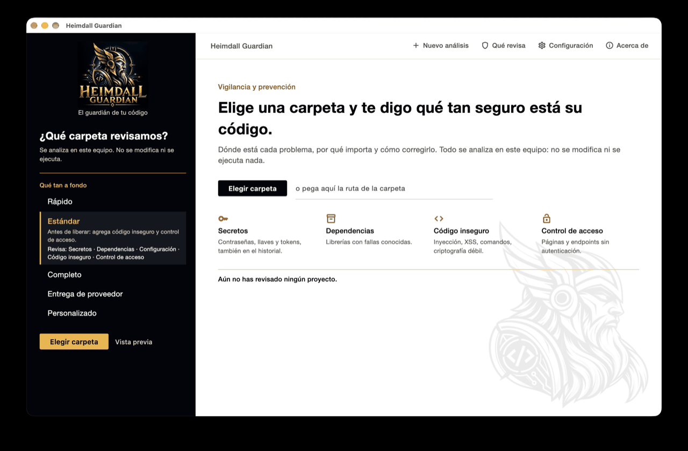
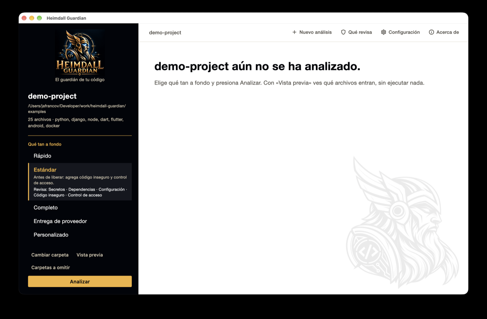
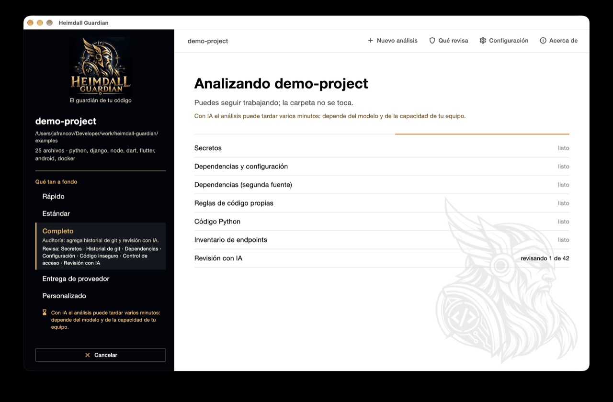
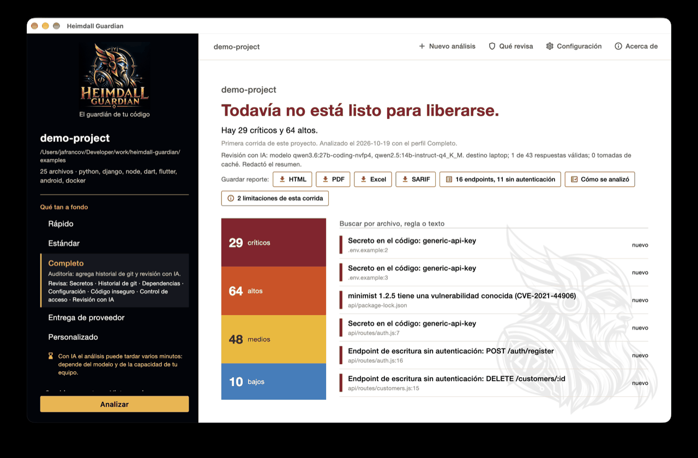
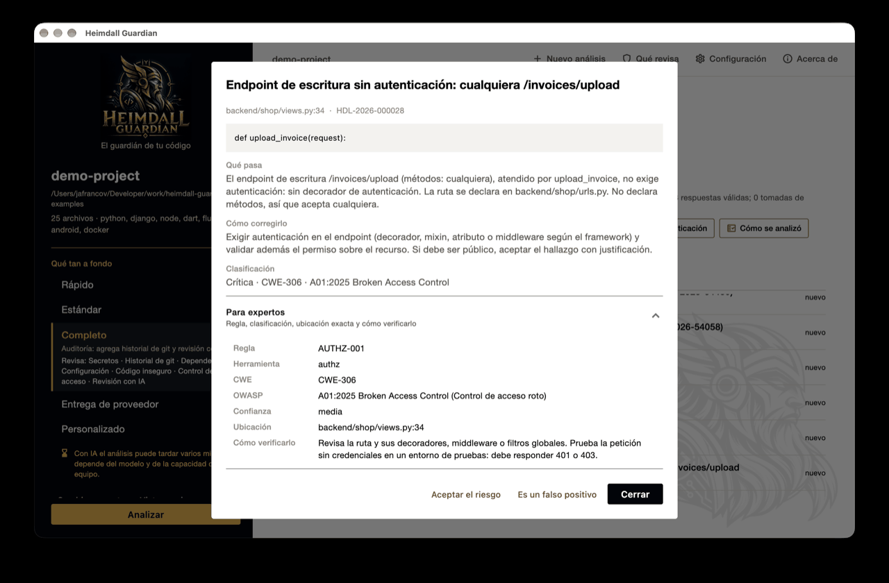
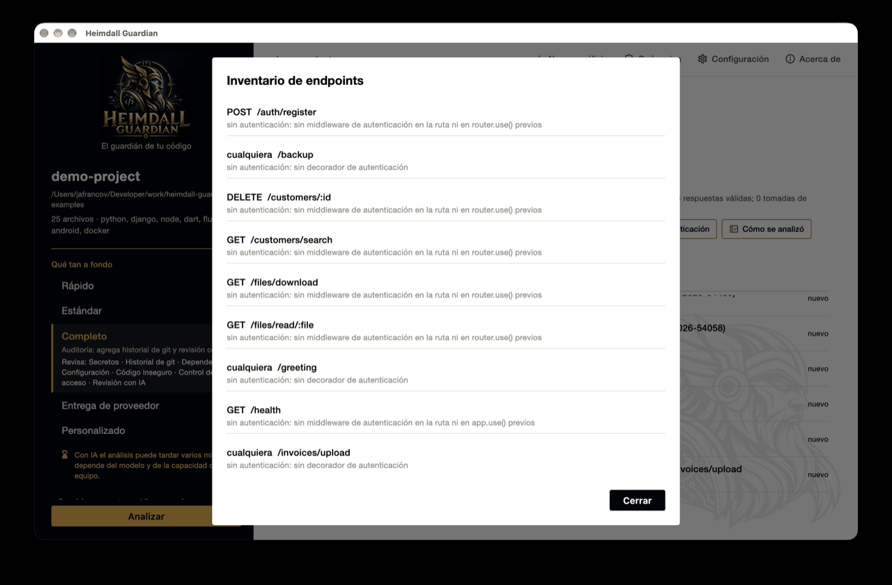
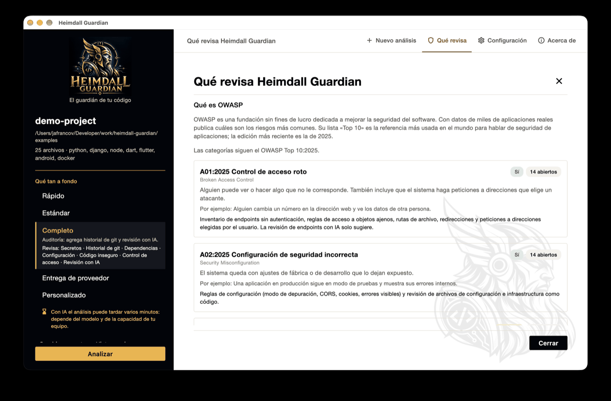
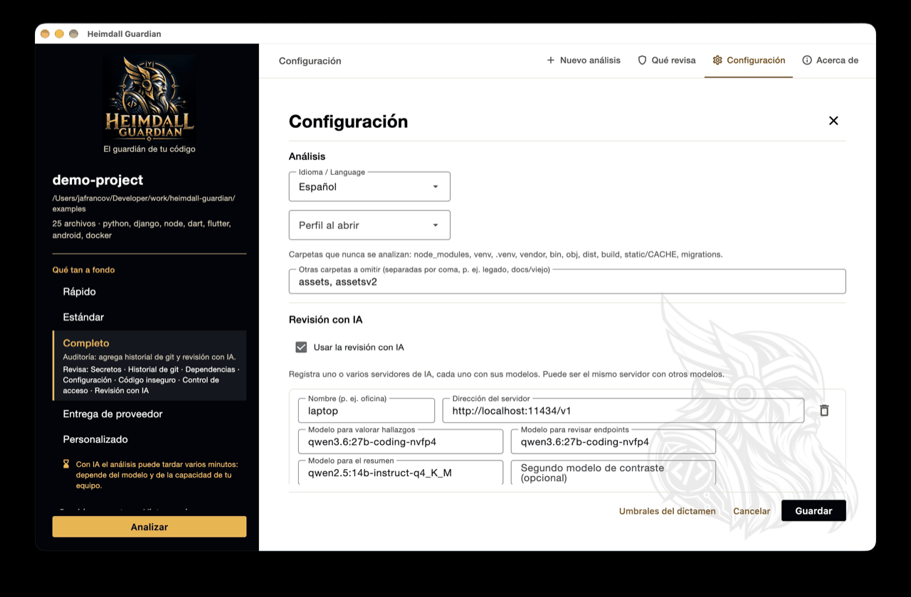
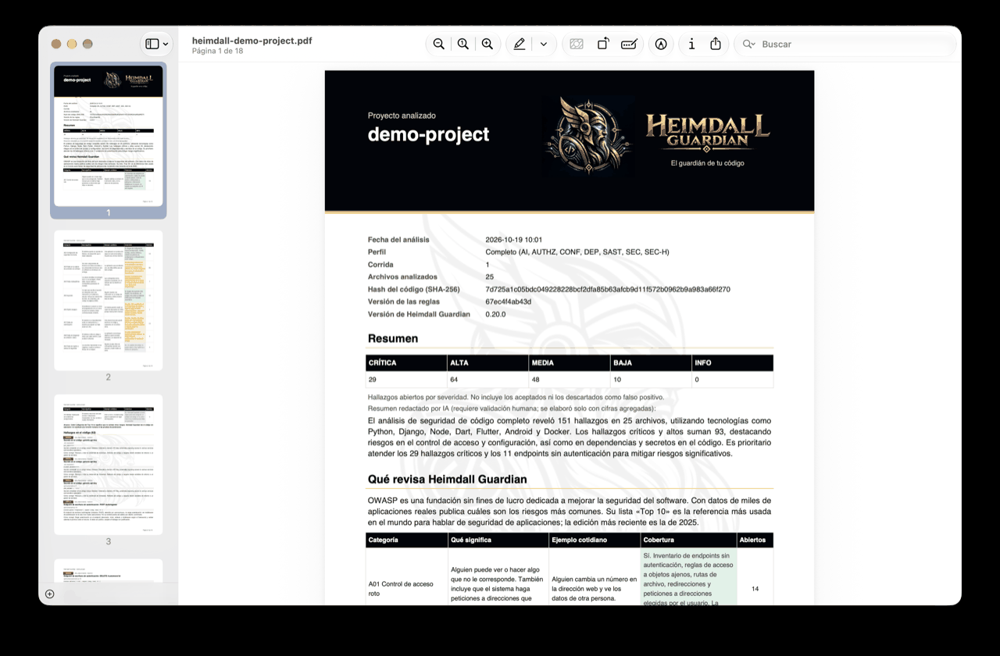

# Recorrido por la app

Una pantalla a la vez. Haz clic en una imagen para verla más grande en tu navegador.

## Bienvenida

La bienvenida: elige una carpeta y Heimdall Guardian hace el resto. La primera vez aparece una visita guiada corta.

## Elige qué tan a fondo revisar

A la izquierda eliges la carpeta y la profundidad (Rápido, Estándar, Completo, Entrega de proveedor o Personalizado); cada opción lista lo que revisa y **Analizar** queda fijo abajo.

## Avance

Mientras corre, la parte derecha muestra cada paso. No se escribe nada en tu carpeta.

## Resultado

El resultado es una frase con colores de semáforo y una banda por severidad; haz clic en una banda para filtrar la lista y guarda el reporte en HTML, PDF, Excel o SARIF.

## Detalle de un hallazgo

Cada hallazgo explica qué pasa y cómo corregirlo; **Para expertos** agrega la regla, el CWE, la categoría OWASP, la ubicación y cómo verificarlo, y puedes aceptar el riesgo o marcar un falso positivo.

## Endpoints

El inventario de endpoints lista cada ruta encontrada y si exige autenticación.

## Qué revisa

Esta pantalla explica en palabras sencillas qué es OWASP Top 10:2025 y qué categorías cubre Heimdall: por completo, en parte o no.

## Configuración

Aquí están el idioma (cambia al instante), las carpetas que se omiten por defecto, la actualización de bases y la revisión con IA local.

## Reporte en PDF

El reporte en PDF abre con una portada que registra el proyecto, el perfil y la fecha, y sigue con todo el detalle.

## Instalador

En macOS se instala arrastrando la app a Aplicaciones desde la imagen de disco.

