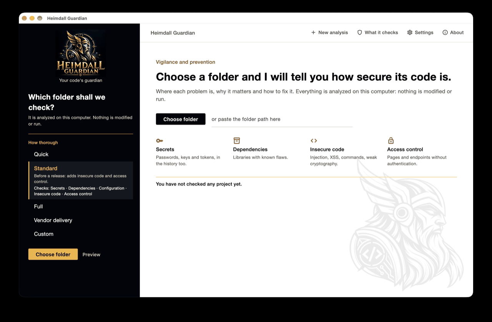
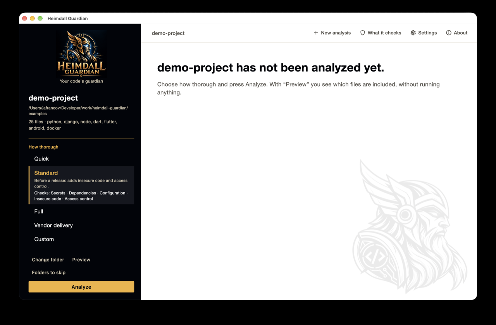
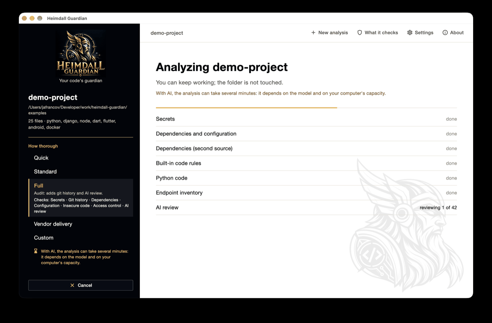
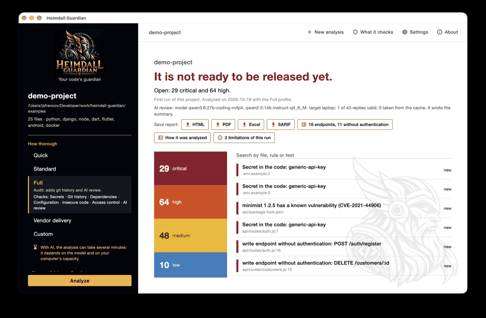
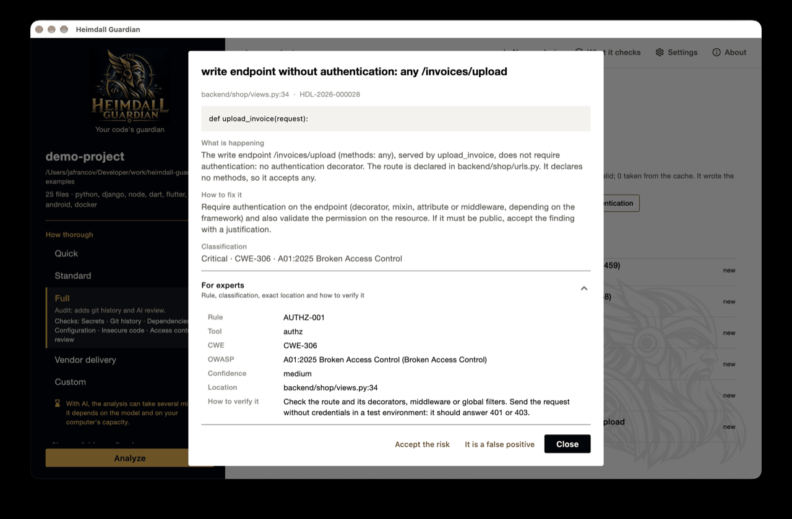
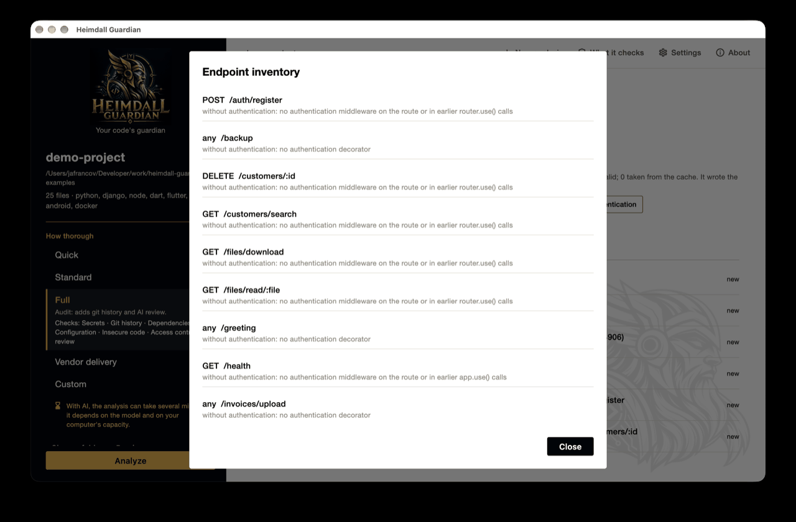
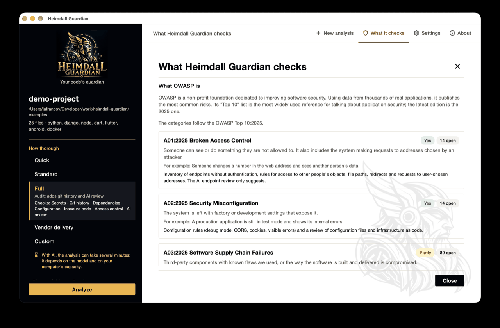
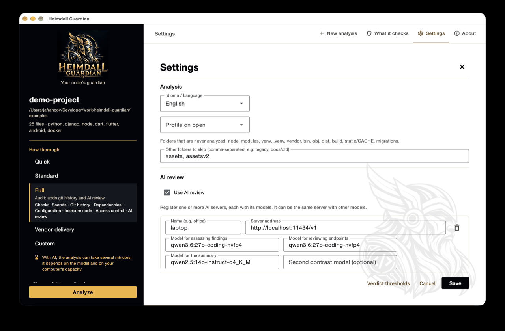
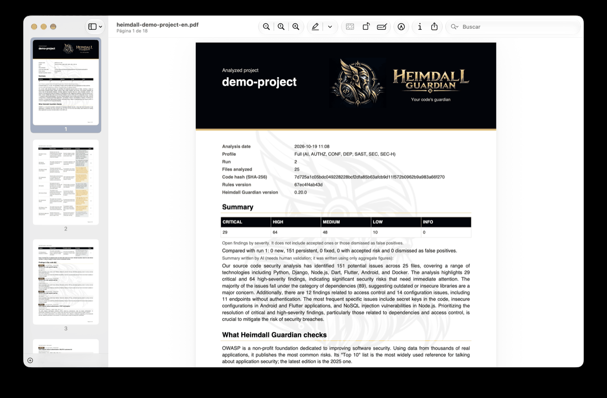
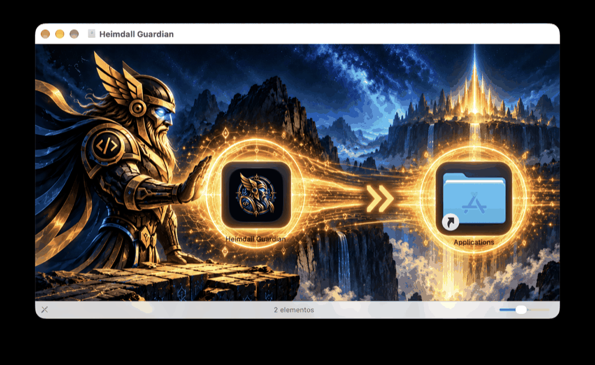

# Desktop app tour

One screen at a time. Click any image to see it larger in your browser.

## Welcome

The welcome screen: choose a folder and Heimdall Guardian does the rest. A short guided tour appears the first time.

## Choose how thorough the review is

On the left you pick the folder and a depth (Quick, Standard, Full, Vendor delivery or Custom); each option lists what it checks, and **Analyze** stays pinned at the bottom.

## Progress

While it runs, the right side shows each step. Nothing is written to your folder.

## Result

The result is a sentence in traffic-light colors plus one band per severity; click a band to filter the list and save the report in HTML, PDF, Excel or SARIF.

## Finding detail

Each finding explains what is happening and how to fix it; **For experts** adds the rule, CWE, OWASP category, location and how to verify it, and you can accept the risk or mark a false positive.

## Endpoints

The endpoint inventory lists every route found and whether it requires authentication.

## What it checks

This screen explains in plain words what OWASP Top 10:2025 is and which categories Heimdall covers, fully, partly or not at all.

## Settings

Settings holds the language (it changes live), the folders skipped by default, database updates and the local AI review.

## PDF report

The PDF report opens with a cover that records the project, the profile and the date, followed by the full detail.

## Installer

On macOS you install by dragging the app onto Applications from the disk image.

