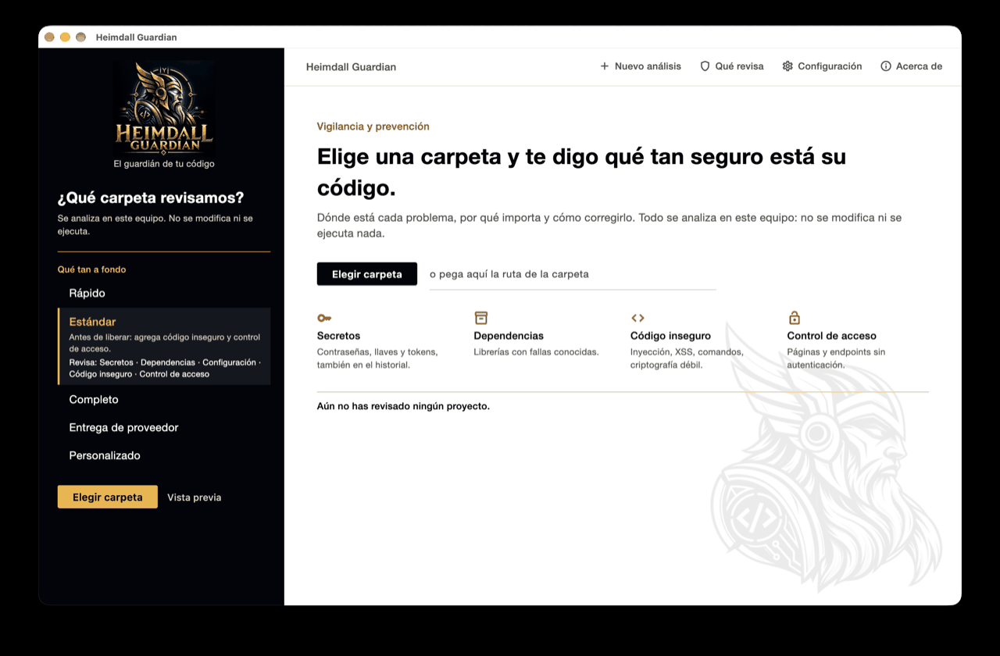
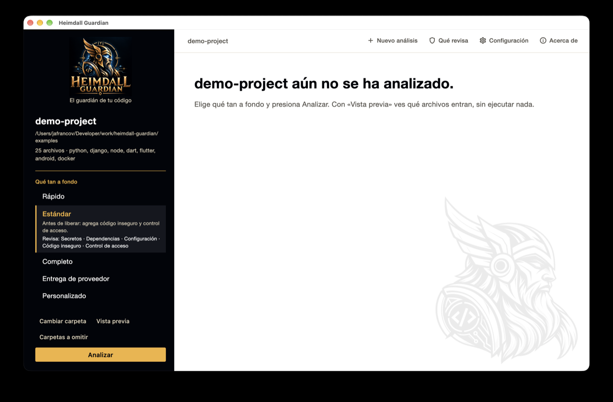
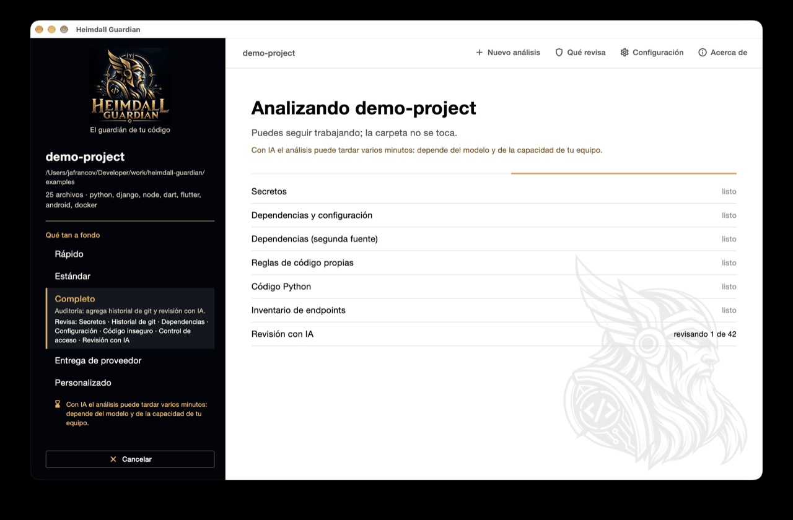
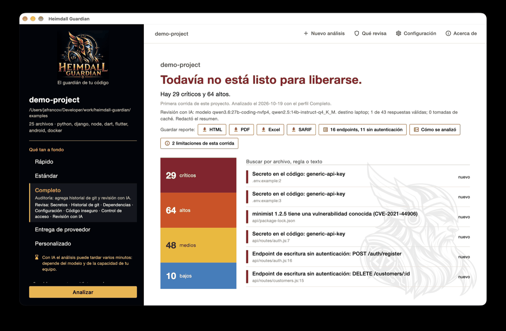
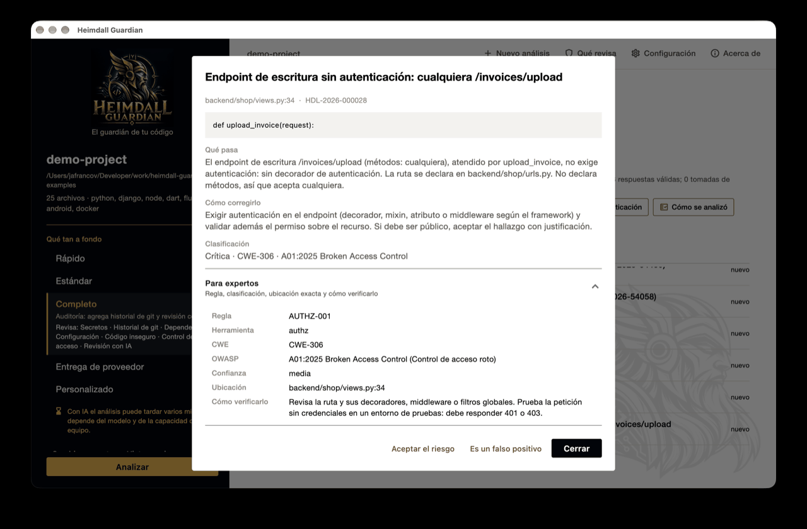

# Primeros pasos

## Descarga e instala

Lo más sencillo es la aplicación de escritorio: sin Python, sin terminal y sin
herramientas adicionales.

| Sistema | Estado | Cómo |
|---|---|---|
| macOS (Apple Silicon) | Disponible | Descarga el `.dmg` de la [página de versiones](https://github.com/jafrancov/heimdall-guardian/releases), ábrelo y arrastra **Heimdall Guardian** a **Aplicaciones**. |
| Windows (x64) | Disponible | Descarga `heimdall-guardian-<versión>-windows-x64-setup.exe` de la [página de versiones](https://github.com/jafrancov/heimdall-guardian/releases) y ejecútalo. SmartScreen avisa la primera vez: pulsa **Más información** y luego **Ejecutar de todas formas**. |
| Linux (x64, Debian/Ubuntu) | Disponible | Descarga `heimdall-guardian_<versión>_amd64.deb` de la [página de versiones](https://github.com/jafrancov/heimdall-guardian/releases) y ejecuta `sudo apt install ./heimdall-guardian_<versión>_amd64.deb`, o extrae el `.tar.gz` y ejecuta el binario dentro de su carpeta `app/`. |


!!! note "La primera vez que la abras en macOS"
    La aplicación aún no está firmada con un Apple Developer ID, así que macOS avisa la
    primera vez. En **Aplicaciones**, **clic derecho → Abrir** y confirma **Abrir**. Solo
    hace falta una vez.

Al iniciar por primera vez verás una visita guiada corta que explica qué hace la
aplicación y qué no. Todo corre en tu equipo; no se envía nada fuera.

## Tu primer análisis

No necesitas ser experto en seguridad. Para practicar, usa el proyecto de demostración,
pequeño y vulnerable a propósito, en `examples/demo-project` (nunca lo despliegues ni lo
ejecutes).

1. **Abre la aplicación** y elige una carpeta.

    

2. **Elige qué tan a fondo revisar.** Cada opción lista lo que revisa.

    

3. **Pulsa Analizar** y mira el avance. No se escribe nada en tu carpeta.

    

4. **Lee el resultado:** una frase con colores de semáforo y una banda por severidad. Haz
   clic en una banda para filtrar la lista.

    

5. **Abre un hallazgo** para ver qué pasa y cómo corregirlo. **Para expertos** agrega la
   regla, el CWE, la categoría OWASP y cómo verificarlo.

    

6. **Decide:** corrige el código y analiza de nuevo, o **Acepta el riesgo** o marca **Es un
   falso positivo**, con una justificación. El resultado se actualiza al instante.

Mira todas las pantallas en el [recorrido por la app](app-tour.md).

## Bases de vulnerabilidades

La revisión de dependencias necesita las bases de vulnerabilidades, que no vienen
incluidas (unos 2 GB). En la aplicación usa **Actualizar las bases ahora** o la casilla
**Actualizar las bases al analizar**. Sin bases el análisis corre igual y avisa que no se
revisaron las dependencias. Para equipos sin conexión usa `hdl databases --export` e
`--import`.

## Perfiles

| Perfil | Para qué | Qué revisa |
|---|---|---|
| `quick` | Revisión diaria | Secretos, dependencias y configuración |
| `standard` | Antes de publicar | Lo anterior, más código inseguro y control de acceso |
| `full` | Auditoría | Lo anterior, más historial de git y revisión con IA |
| `vendor` | Recibir código de terceros | Lo anterior, más SBOM y dictamen |
| `custom` | Tú eliges | `--modules SEC,DEP,SAST,...` |

## Idioma

Elige el idioma en **Ajustes → Idioma** de la aplicación; cambia al instante. Los reportes
se pueden regenerar en el otro idioma sin volver a analizar.

## Automatización y CI

La línea de comandos `hdl` hace el mismo análisis sin ventana, para scripts e integración
continua. Para correrla desde el código necesitas Python 3.12 o superior,
[uv](https://docs.astral.sh/uv/), git y [pre-commit](https://pre-commit.com/).

```bash
git clone https://github.com/jafrancov/heimdall-guardian.git
cd heimdall-guardian
make setup
```

`make setup` instala las dependencias, descarga Gitleaks, OSV-Scanner, Opengrep y Trivy en
las versiones fijadas en `tools/tools.toml` (verificando su SHA-256) y activa los ganchos
de calidad.

```bash
uv run hdl databases --update
uv run hdl ui                           # la aplicación de escritorio desde el código
uv run hdl scan <carpeta> --profile standard --output reporte.html
uv run hdl scan <carpeta> --dry-run      # qué se analizaría, sin ejecutar nada
uv run hdl report <carpeta> --output reporte.pdf --output reporte.xlsx
uv run hdl scan examples/demo-project --profile standard --output demo.html
```

El formato de cada `--output` sale de su extensión: `.html`, `.pdf`, `.xlsx`, `.sarif`,
`.json` o `.cdx.json` (SBOM). Los reportes no se pueden guardar dentro de la carpeta
analizada.

Para recibir código de un proveedor:

```bash
uv run hdl scan <carpeta> --profile vendor --issuer "Tu nombre" \
  --output dictamen.pdf --output sbom.cdx.json
```

El dictamen aplica umbrales (por ejemplo, cero hallazgos críticos, cero secretos, cero
endpoints de escritura sin autenticación). Consúltalos con `hdl thresholds`; cambiarlos
pide un PIN y queda en una bitácora. El idioma de la línea de comandos se elige con
`hdl --lang es ...` o la variable de entorno `HDL_LANG`.

Consulta la [referencia de la línea de comandos](cli.md) para ver cada comando.

### Instalar solo el comando

Para usar `hdl` sin la aplicación de escritorio (un servidor, una máquina de CI, un flujo
solo de terminal) necesitas tu propio Python 3.12 o superior de
[python.org](https://www.python.org/downloads/); el Python que trae macOS o Xcode es
demasiado viejo. Descarga `install_hdl.py` de la
[página de versiones](https://github.com/jafrancov/heimdall-guardian/releases) (la
aplicación de escritorio también lo trae) y ejecútalo. Con la aplicación de escritorio ni
siquiera lo necesitas: ofrece instalar el comando la primera vez que se abre, y otra vez en
Configuración, en "Línea de comandos" (necesita Python 3.12 o superior en el equipo y te
dice dónde conseguirlo si falta). En un servidor sin escritorio, descarga de la misma
página el archivo solo de línea de comandos `heimdall-guardian-cli-<versión>.tar.gz`: trae
`install_hdl.py`, el paquete `.whl` y un README corto, así que
`python3 install_hdl.py --wheel <el archivo .whl>` instala sin descargar el paquete. En Debian
y Ubuntu, instala antes `python3-venv` (`sudo apt install python3-venv`): sin él, el
instalador no puede crear su entorno virtual.

```bash
python3 install_hdl.py              # crea su propio entorno virtual y enlaza `hdl`
hdl tools --install                 # descarga Gitleaks, OSV-Scanner, Opengrep y Trivy
hdl databases --update              # bases de vulnerabilidades
```

El entorno vive en la carpeta de datos (`<datos>/cli/venv`), nada más de tu Python cambia y
`hdl` queda enlazado en `~/.local/bin` (en Windows, un acceso bajo
`%LOCALAPPDATA%\Programs\Heimdall Guardian\bin` que se agrega a tu PATH de usuario).
Comparte herramientas, bases e historial con la aplicación de escritorio: si la app está
instalada, `hdl` reutiliza sus herramientas. `hdl tools --install` descarga cada binario
fijado y verifica su SHA-256 antes de instalarlo; en un equipo sin internet, copia la
carpeta `tools` desde uno que tenga la app. Para quitar el comando, ejecuta
`python3 install_hdl.py --uninstall`: borra el entorno y el enlace, nunca tus bases,
historial ni ajustes.

Sin la app ni el script también puedes usar un instalador de herramientas de Python, cuando
el paquete esté publicado en PyPI (cuando se publique): `uv tool install heimdall-guardian` o
`pipx install heimdall-guardian`, y luego `hdl tools --install` para obtener las herramientas
fijadas. De cualquier forma, `hdl version --check` consulta GitHub (solo cuando lo ejecutas, sin
enviar nada de tu código) si hay una versión nueva y te dice dónde descargarla; `hdl tools --news`
incluye la misma línea. En la app de escritorio, "Buscar actualizaciones" en Acerca de hace lo mismo.
