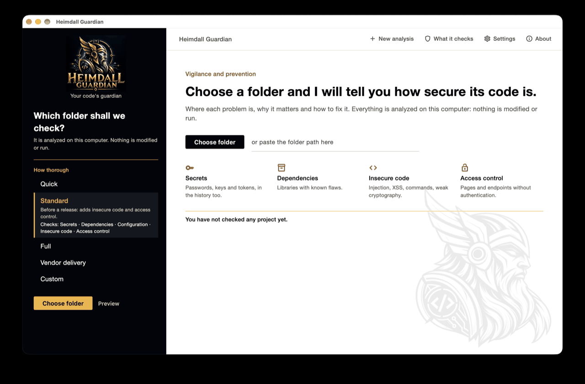
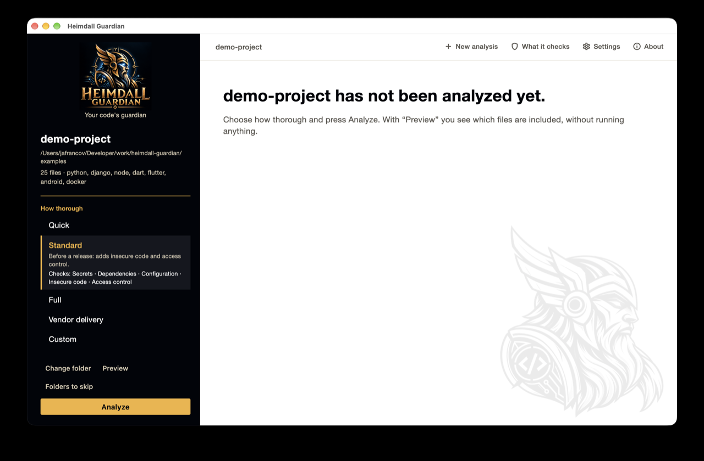
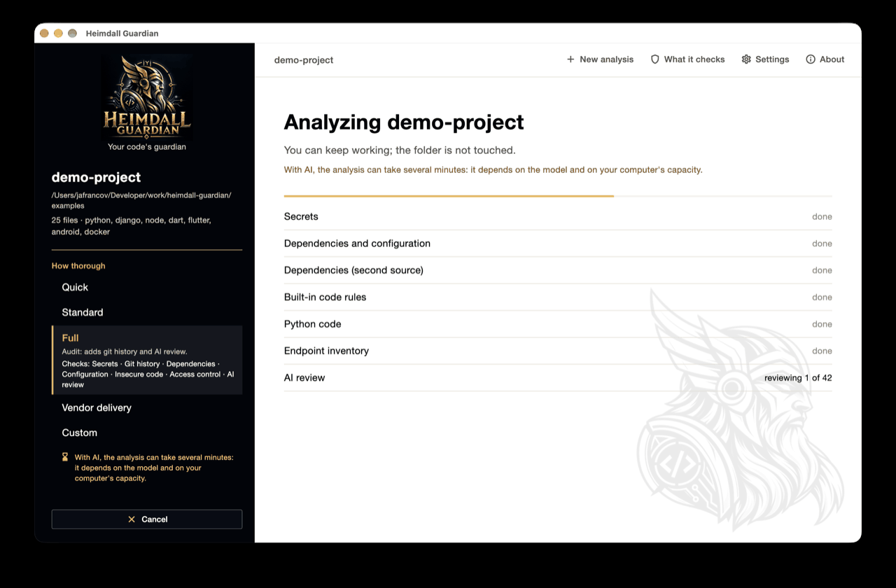
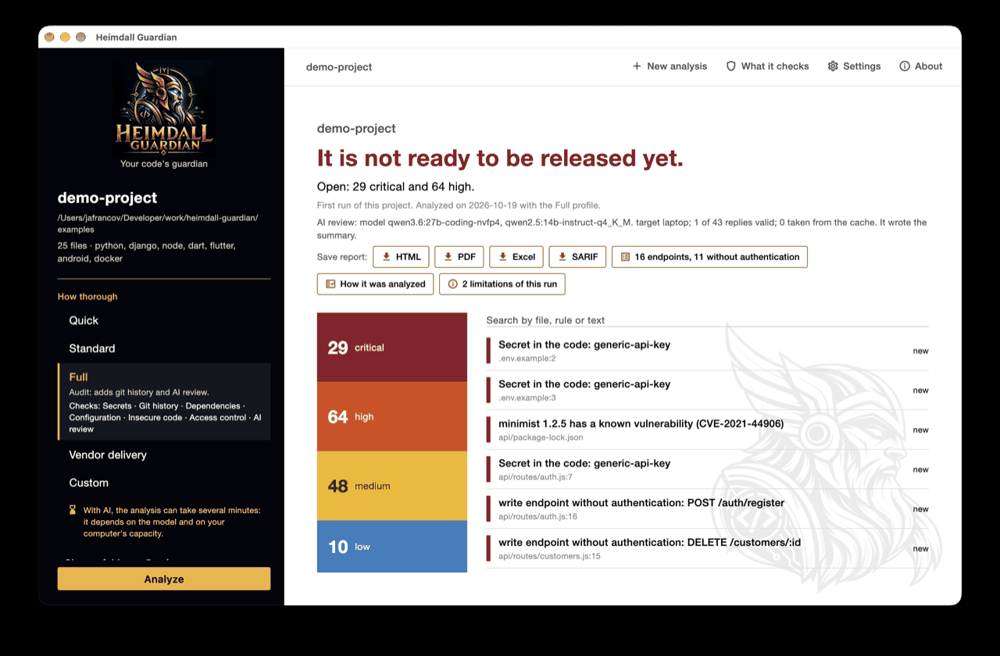
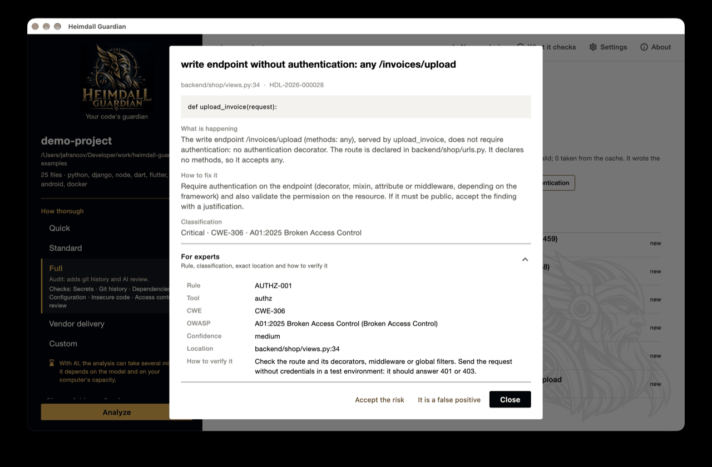

# Getting started

## Download and install

The simplest way is the desktop app: no Python, no terminal and no extra tools.

| System | Status | How |
|---|---|---|
| macOS (Apple Silicon) | Available | Download the `.dmg` from the [releases page](https://github.com/jafrancov/heimdall-guardian/releases), open it and drag **Heimdall Guardian** onto **Applications**. |
| Windows (x64) | Available | Download `heimdall-guardian-<version>-windows-x64-setup.exe` from the [Releases page](https://github.com/jafrancov/heimdall-guardian/releases) and run it. SmartScreen warns the first time: click **More info** and then **Run anyway**. |
| Linux (x64, Debian/Ubuntu) | Available | Download `heimdall-guardian_<version>_amd64.deb` from the [Releases page](https://github.com/jafrancov/heimdall-guardian/releases) and run `sudo apt install ./heimdall-guardian_<version>_amd64.deb`, or extract the `.tar.gz` and run the binary inside its `app/` folder. |


!!! note "First time you open it on macOS"
    The app is not yet signed with an Apple Developer ID, so macOS warns you the first
    time. In **Applications**, **right click → Open** and confirm **Open**. You only need
    to do this once.

The first time it starts, a short guided tour explains what the app does and what it does
not do. Everything runs on your machine; nothing is sent out.

## Your first analysis

You do not need to be a security expert. To practice, use the small, deliberately
vulnerable demo project in `examples/demo-project` (never deploy or run it).

1. **Open the app** and choose a folder.

    

2. **Choose how thorough the review should be.** Each option lists what it checks.

    

3. **Press Analyze** and watch the progress. Nothing is written to your folder.

    

4. **Read the result:** a sentence in traffic-light colors and a band per severity. Click a
   band to filter the list.

    

5. **Open a finding** to see what is happening and how to fix it. **For experts** adds the
   rule, CWE, OWASP category and how to verify it.

    

6. **Decide:** fix the code and analyze again, or **Accept the risk** or mark **It is a
   false positive**, with a justification. The result updates immediately.

See every screen in the [desktop app tour](app-tour.md).

## Vulnerability databases

The dependency check needs the vulnerability databases, which are not included (about
2 GB). In the app, use **Update the databases now** or the **Update the databases when
analyzing** checkbox. Without databases the analysis still runs and warns that
dependencies were not checked. For offline machines, use `hdl databases --export` and
`--import`.

## Profiles

| Profile | What for | What it checks |
|---|---|---|
| `quick` | Daily check | Secrets, dependencies and configuration |
| `standard` | Before a release | The above, plus insecure code and access control |
| `full` | Audit | The above, plus git history and AI review |
| `vendor` | Receiving third-party code | The above, plus SBOM and verdict |
| `custom` | You choose | `--modules SEC,DEP,SAST,...` |

## Language

Choose the language in **Settings → Language** in the app; it changes live. Reports can be
regenerated in the other language without scanning again.

## Automation and CI

The `hdl` command line runs the same analysis without a window, for scripts and
continuous integration. To run it from source you need Python 3.12 or later,
[uv](https://docs.astral.sh/uv/), git and [pre-commit](https://pre-commit.com/).

```bash
git clone https://github.com/jafrancov/heimdall-guardian.git
cd heimdall-guardian
make setup
```

`make setup` installs the dependencies, downloads Gitleaks, OSV-Scanner, Opengrep and
Trivy at the versions pinned in `tools/tools.toml` (verifying their SHA-256) and enables
the quality hooks.

```bash
uv run hdl databases --update
uv run hdl ui                           # the desktop app from source
uv run hdl scan <folder> --profile standard --output report.html
uv run hdl scan <folder> --dry-run      # what would be analyzed, nothing is run
uv run hdl report <folder> --output report.pdf --output report.xlsx
uv run hdl scan examples/demo-project --profile standard --output demo.html
```

The format of each `--output` comes from its extension: `.html`, `.pdf`, `.xlsx`,
`.sarif`, `.json` or `.cdx.json` (SBOM). Reports cannot be saved inside the analyzed
folder.

To receive code from a vendor:

```bash
uv run hdl scan <folder> --profile vendor --issuer "Your name" \
  --output verdict.pdf --output sbom.cdx.json
```

The verdict applies thresholds (for example, zero critical findings, zero secrets, zero
unauthenticated write endpoints). View them with `hdl thresholds`; changing them asks for
a PIN and is logged. The command line language is chosen with `hdl --lang en ...` or the
`HDL_LANG` environment variable.

See the [CLI reference](cli.md) for every command.

### Install only the command

To use `hdl` without the desktop app (a server, a CI machine, a terminal-only workflow) you
need your own Python 3.12 or later from [python.org](https://www.python.org/downloads/); the
Python that comes with macOS or Xcode is too old. Get `install_hdl.py` from the
[release page](https://github.com/jafrancov/heimdall-guardian/releases) (the desktop app
also carries it) and run it. With the desktop app you do not even need that: it offers to
install the command the first time it opens, and again in Settings, under "Command line"
(it needs Python 3.12 or later on the computer and tells you where to get it if missing).
On a server without a desktop, download the CLI-only archive
`heimdall-guardian-cli-<version>.tar.gz` from the same page: it holds `install_hdl.py`, the
wheel and a short README, so `python3 install_hdl.py --wheel <the .whl file>` installs
without downloading the package. On Debian and Ubuntu, install `python3-venv` first
(`sudo apt install python3-venv`): without it the installer cannot create its virtual
environment.

```bash
python3 install_hdl.py              # creates its own virtual environment and links `hdl`
hdl tools --install                 # downloads Gitleaks, OSV-Scanner, Opengrep and Trivy
hdl databases --update              # vulnerability databases
```

The environment lives in the data folder (`<data>/cli/venv`), nothing else on your Python
changes, and `hdl` is linked in `~/.local/bin` (on Windows, a shim under
`%LOCALAPPDATA%\Programs\Heimdall Guardian\bin` that is added to your user PATH). It shares
the tools, databases and history with the desktop app: if the app is installed, `hdl` reuses
its tools. `hdl tools --install` downloads each pinned binary and checks its SHA-256 before
installing it; on a machine without internet, copy the `tools` folder from one that has the
app. To remove the command, run `python3 install_hdl.py --uninstall`: it deletes the
environment and the link, never your databases, history or settings.

Without the app or the script you can also use a Python tool installer, once the package is
published on PyPI (when published): `uv tool install heimdall-guardian` or
`pipx install heimdall-guardian`, then `hdl tools --install` to get the pinned tools. Either
way, `hdl version --check` asks GitHub (only when you run it, sending nothing from your code)
whether a newer release exists and tells you where to download it; `hdl tools --news` includes
the same line. In the desktop app, "Check for updates" in About does the same.
