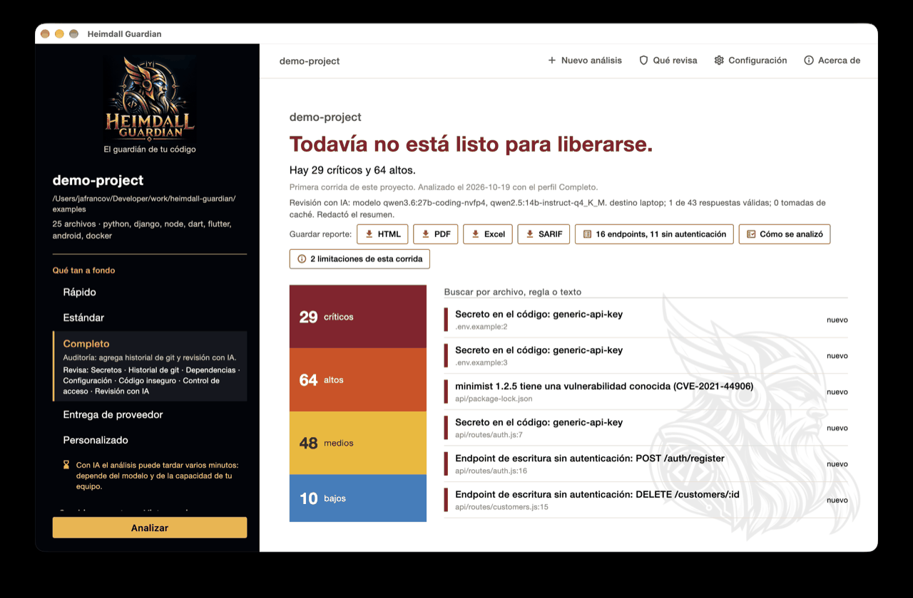

# Heimdall Guardian

**El guardián de tu código. Vigilancia y prevención.**

Heimdall Guardian revisa la seguridad del código fuente de una carpeta y te dice qué
problema hay, dónde está (archivo y línea), por qué importa y cómo corregirlo. Corre en tu
equipo: no modifica la carpeta, no ejecuta su código y no envía nada fuera de tu red.

Es un escáner local de seguridad estático y de solo lectura (secretos, dependencias
vulnerables, código inseguro, endpoints sin autenticación), con aplicación de escritorio y
la línea de comandos `hdl`. La interfaz, los reportes y la revisión con IA están en inglés
y en español.

!!! note "Nombre y marcas"
    Heimdall Guardian es un proyecto independiente de código abierto. No está afiliado,
    patrocinado ni respaldado por ninguna empresa, producto o marca de nombre parecido.

## Empieza en minutos

1. **Descarga la aplicación** para macOS de la [página de versiones](https://github.com/jafrancov/heimdall-guardian/releases) (Windows y Linux: próximamente).
2. **Ábrela, elige una carpeta** y presiona **Analizar**.
3. **Lee el resultado:** una frase, una banda por severidad y, en cada hallazgo, cómo corregirlo.

- [Primeros pasos](getting-started.md): descarga, instalación y tu primer análisis.
- [Recorrido por la app](app-tour.md): cada pantalla, una frase por cada una.

## Principios

1. **Solo lectura.** Nunca escribe dentro de la carpeta analizada.
2. **Nunca ejecuta el código analizado.** Las dependencias se leen de los archivos de
   bloqueo y los manifiestos; no se instala ni se compila nada.
3. **Tu código no sale de tu red.** La IA solo puede apuntar a `localhost` o a un servidor
   interno que tú autorices, por HTTPS. Los modelos en la nube se rechazan.
4. **Funciona sin internet.** Las herramientas viajan con versiones fijas y verificadas; las
   bases de vulnerabilidades se actualizan solo cuando lo pides.
5. **Primero lo determinista, después la IA.** La IA sugiere y nunca decide.
6. **Trazabilidad.** Cada reporte registra el hash del código analizado y las versiones de
   herramientas, reglas, bases y modelo.

## A dónde ir después

- [Qué revisa](checks.md) y [Stacks soportados](stacks.md).
- [Catálogo de reglas](rules/index.md): cada regla propia, con la forma de corregirla.
- [Referencia de la línea de comandos](cli.md): para scripts y CI.
- [Revisar hallazgos](reviewing.md): aceptar un riesgo, marcar un falso positivo, compartir una línea base.
- Descargas y la descripción completa del proyecto: el
  [README](https://github.com/jafrancov/heimdall-guardian/blob/main/README.es.md) y la
  [página de versiones](https://github.com/jafrancov/heimdall-guardian/releases).

!!! warning "Es análisis estático"
    No reemplaza una prueba de penetración ni la revisión manual de la lógica de negocio.
    Un resultado limpio no significa que el código sea seguro.

Código y reglas bajo [Apache-2.0](https://github.com/jafrancov/heimdall-guardian/blob/main/LICENSE).
