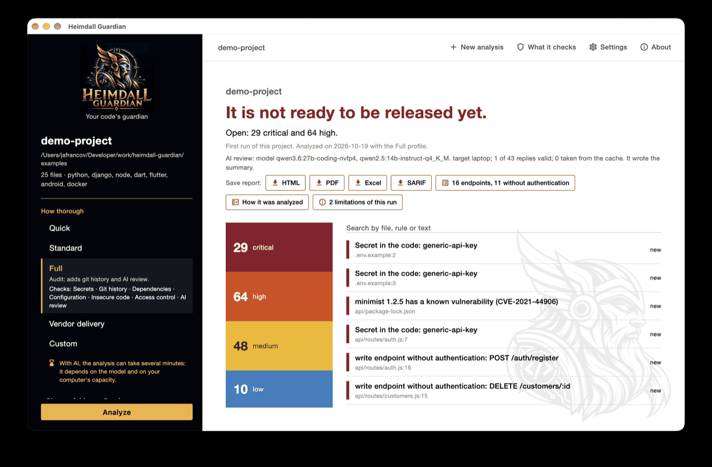

# Heimdall Guardian

**Your code's guardian. Vigilance and prevention.**

Heimdall Guardian reviews the security of the source code in a folder and tells you what
the problem is, where it is (file and line), why it matters and how to fix it. It runs on
your machine: it does not modify the folder, does not run its code and sends nothing
outside your network.

It is a local, read-only static security scanner (secrets, vulnerable dependencies,
insecure code, unauthenticated endpoints) with a desktop app and the `hdl` command line.
The interface, the reports and the AI review are available in English and Spanish.

!!! note "Name and trademarks"
    Heimdall Guardian is an independent open-source project. It is not affiliated with,
    sponsored or endorsed by any company, product or brand with a similar name.

## Get started in minutes

1. **Download the app** for macOS from the [releases page](https://github.com/jafrancov/heimdall-guardian/releases) (Windows and Linux: coming soon).
2. **Open it, choose a folder** and press **Analyze**.
3. **Read the result:** a sentence, a band per severity and, for each finding, how to fix it.

- [Getting started](getting-started.md): download, install and your first analysis.
- [Desktop app tour](app-tour.md): every screen, one sentence each.

## Principles

1. **Read-only.** It never writes inside the analyzed folder.
2. **It never runs the analyzed code.** Dependencies are read from lock files and
   manifests; nothing is installed or compiled.
3. **Your code does not leave your network.** The AI can only point to `localhost` or to
   an internal server that you authorize, over HTTPS. Cloud models are rejected.
4. **It works offline.** The tools ship with pinned, verified versions; the vulnerability
   databases are updated only when you ask.
5. **Deterministic first, AI second.** The AI suggests and never decides.
6. **Traceability.** Every report records the hash of the analyzed code and the versions
   of tools, rules, databases and model.

## Where to go next

- [What it checks](checks.md) and [Supported stacks](stacks.md).
- [Rules catalog](rules/index.md): every own rule, with how to fix it.
- [Reviewing findings](reviewing.md): accept a risk, mark a false positive, share a baseline.
- [CLI reference](cli.md): for scripts and CI (Automation and CI).
- Downloads and the full project overview: the
  [README](https://github.com/jafrancov/heimdall-guardian#readme) and the
  [releases page](https://github.com/jafrancov/heimdall-guardian/releases).

!!! warning "It is static analysis"
    It does not replace penetration testing or manual review of business logic. A clean
    result does not mean the code is secure.

Code and rules are under [Apache-2.0](https://github.com/jafrancov/heimdall-guardian/blob/main/LICENSE).
